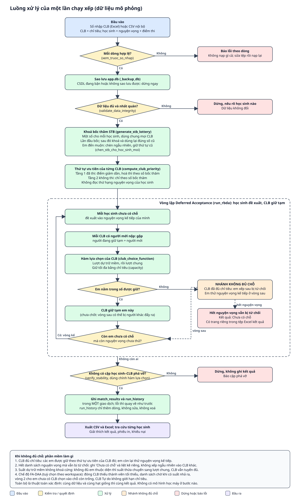
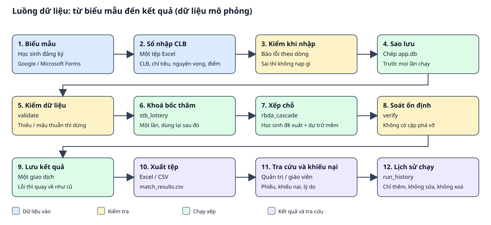

# Báo cáo lịch sử thay đổi và sơ đồ luồng xử lý

> **Dữ liệu mô phỏng.** Mọi tên và điểm trong dự án do máy sinh với hạt giống cố định, không phải học sinh hay khảo sát thật.
> Báo cáo chỉ nêu sự việc đọc từ lịch sử git; nhận xét về mức đóng góp và mọi kết luận do học sinh thực hiện đề tài tự viết.
> Tệp này do `docs/giai_trinh/tao_lich_su.py` sinh ra từ git, mốc đối chiếu `fd40227`. Không sửa tay; sửa script rồi chạy lại.

## 1. Cách đối chiếu

Mỗi mã trong báo cáo là mã commit rút gọn. Xem một commit (tiêu đề, ngày, tệp đổi, nội dung đổi):

```bash
git show --stat <mã>
git log --oneline --follow -- rbda_priority_pipeline.py
```

Trên web: `https://github.com/nguyenphanvantruong6969-arch/ClubMatch-Gale-Sharpley-/commit/<mã đầy đủ>`. Bảng đầy đủ mọi commit: `docs/giai_trinh/LICH_SU_COMMIT.csv` (mã, ngày, tác giả, tiêu đề, số tệp).
Cần clone đầy đủ: nếu `git rev-parse --is-shallow-repository` in `true` thì chạy `git fetch --unshallow origin`.

## 2. Số liệu tổng quan

| Mục | Giá trị |
|---|---|
| Số commit | 1339 (trong đó 93 commit gộp nhánh) |
| Khoảng thời gian trong kho | 2026-10-24 đến 2026-11-22 |
| Commit gốc | `e08af78a6955227f65bab42d2e7dae2a5c147c18` |
| Tệp test Python | 380 |
| Yêu cầu gộp PR vào nhánh chính | 23 (mục 5) |
| Commit của: Claude Code (theo yêu cầu và duyệt của Truong) | 1316 |
| Commit của: Tài khoản của Truong (gộp yêu cầu gộp PR) | 23 |

Commit theo tháng: 2026-10: 108; 2026-11: 1231.

Nhãn tác giả được quy từ hai danh tính git; tên hiển thị và thư điện tử không in ở đây. Các commit của tài khoản Truong đều là commit gộp PR.

## 3. Minh chứng và commit tương ứng

Mỗi phần ứng với một ý của yêu cầu "Bổ sung bằng chứng kỹ thuật và làm rõ vai trò của AI". Ngày và tiêu đề lấy nguyên từ git.

### A. Kho mã nguồn và lịch sử thay đổi

Ứng với yêu cầu: "Kho mã và lịch sử thay đổi". Kho có một commit gốc duy nhất; mọi thay đổi sau đó là commit riêng, có ngày, tiêu đề mang mã mục (mục 6).

| Commit | Ngày | Tác giả git | Tiêu đề commit | Chứng minh |
|---|---|---|---|---|
| `e08af78` | 2026-10-24 | Claude Code | Chuyển toàn bộ nội dung từ RB-STUFF-AFTER-UP sang TESTING-DEV | Commit gốc 24/10/2026: nhập toàn bộ mã sản phẩm từ kho cũ `RB-STUFF-AFTER-UP` (392 tệp: thuật toán, giao diện, test, quy trình CI) |
| `54a5cf4` | 2026-10-27 | Tài khoản của Truong | A13: Điểm quyết tâm (vòng 1–5) (#1) | Yêu cầu gộp PR #1 (A13), PR đầu tiên vào nhánh chính |
| `77b1cb9` | 2026-10-28 | Claude Code | A13.11: CHANGELOG, TIEN_DO, sổ đăng ký, cập nhật VAN_DE_STRESS_TEST | Ví dụ một mục đóng đủ vòng: mã, CHANGELOG, TIEN_DO, sổ đăng ký cùng được cập nhật (A13.11) |

### B. Phần mã cốt lõi: thuật toán ghép

Ứng với yêu cầu: "Mã nguồn/phần mã cốt lõi ... thuật toán ghép". Các hàm lõi nằm trong `rbda_priority_pipeline.py`; mô tả từng lớp ở `docs/CO_CHE_THUAT_TOAN.md`. Các commit sau commit gốc đều thêm tham số mới có mặc định giữ nguyên hành vi cũ (bất biến 1 trong `CLAUDE.md`).

| Commit | Ngày | Tác giả git | Tiêu đề commit | Chứng minh |
|---|---|---|---|---|
| `e08af78` | 2026-10-24 | Claude Code | Chuyển toàn bộ nội dung từ RB-STUFF-AFTER-UP sang TESTING-DEV | Có mặt từ đầu: `run_rbda`, `club_choice_function`, `compute_club_priority`, `generate_stb_lottery`, `chen_stb_cho_hoc_sinh_moi`, `verify_stability`, `validate_data_integrity`, `docs/CO_CHE_THUAT_TOAN.md` |
| `c011f69` | 2026-10-24 | Claude Code | A13: khoá ưu tiên Wharton và nối vào run_rbda | A13: khoá ưu tiên theo điểm quyết tâm nối vào `run_rbda` (tham số mới, mặc định `None` = như cũ) |
| `3c22e0b` | 2026-11-09 | Claude Code | FA-1: data model for FA-DAA (rules.fa_daa, club type columns, giu_cho, So nhap/CSV optiona | FA-1: mô hình dữ liệu của chế độ xếp FA-DAA (huy chương, loại CLB, giữ chỗ) |
| `1037920` | 2026-11-09 | Claude Code | FA-4..FA-8: FA-DAA wrapper, minimum members, reasons and waitlist, demand table, property  | FA-4 đến FA-8: bộ bọc FA-DAA, số thành viên tối thiểu, lý do, danh sách chờ, bảng nhu cầu, test tính chất |
| `adc42d8` | 2026-11-15 | Claude Code | FA-SC-L5: khoá thứ tự bốc thăm theo ngày (bảng stb_buoi); handoff writer | FA-SC-L5: khoá thứ tự bốc thăm theo từng ngày (bảng `stb_buoi`) |
| `c8d81a8` | 2026-11-08 | Claude Code | FA-M3 (part): path B medal placement with gold and silver/bronze-swap questions; all 6 pla | FA-M3: đường B đặt huy chương, đủ 6 cách đặt (ngoại lệ bất biến 2 do Truong duyệt, ghi ở `4a59947`) |
| `77fa953` | 2026-10-28 | Claude Code | Z-SOAT: skill soat-ma (soát mã trước khi push) + test + dòng quy tắc trong CLAUDE.md | Z-SOAT: kỹ năng `soat-ma` và `kiem_nhanh.py`: so từng dòng `match_results` của 3 bộ dữ liệu x 20 hạt giống với nhánh gốc |

### C. Dữ liệu đầu vào, ràng buộc và kiểm lỗi

Ứng với yêu cầu: "Giải thích dữ liệu đầu vào, ràng buộc". Mô tả cột và lỗi: `docs/giai_trinh/DU_LIEU_DAU_VAO.md`. Dưới đây là các commit đưa phần đó vào mã.

| Commit | Ngày | Tác giả git | Tiêu đề commit | Chứng minh |
|---|---|---|---|---|
| `e08af78` | 2026-10-24 | Claude Code | Chuyển toàn bộ nội dung từ RB-STUFF-AFTER-UP sang TESTING-DEV | `so_nhap.py`, `api_nhap.py`: đọc Sổ nhập CLB, báo lỗi theo dòng; sổ lỗi cố ý `SO_NHAP_CO_LOI_CO_Y.xlsx` |
| `a6738ca` | 2026-10-28 | Claude Code | A13.12 (soát nhập backend): kẹp trang (1.6/3.3), create_student_if_missing chuẩn hoá + từ  | A13.12: soát nhập phía backend (kẹp trang, chuẩn hoá mã học sinh, từ chối mã rỗng, sao lưu trước khi xoá CLB) |
| `49c7319` | 2026-10-28 | Claude Code | A13.11 (N3): mọi hàm gặp CSDL bận báo csdl_dang_ban (chờ <= 3 s); chạy xếp dừng ngay khi k | A13.11 (N3): CSDL đang bận báo `csdl_dang_ban`; chạy xếp dừng ngay khi không sao lưu được |
| `fbc82c9` | 2026-11-02 | Claude Code | A14 nền: students.class_id, chuan_hoa_lop, danh từ cohort | A14: thêm lớp của học sinh (`students.class_id`, `chuan_hoa_lop`) |
| `9db3039` | 2026-11-13 | Claude Code | FG-2: xem trước sổ ở workspace FA cảnh báo gom theo mã, mẫu sổ FA, sổ mẫu 120 em | FG-2: xem trước sổ ở chế độ huy chương, cảnh báo gom theo mã; sổ mẫu 120 em |
| `9934af2` | 2026-11-13 | Claude Code | SG-1: block FA run when a selective club has applicants but no scores (C3) | SG-1: chặn chạy FA khi CLB tuyển chọn có đơn mà không có điểm |

### D. Xử lý khi không đủ chỗ

Ứng với yêu cầu: "Cách xử lý khi không đủ chỗ". Nhánh trong sơ đồ 4.1. Mặc định: CLB đủ chỉ tiêu thì giữ theo thứ tự ưu tiên, em còn lại thử nguyện vọng kế tiếp; hết nguyện vọng thì ghi "Chưa có chỗ". Các commit dưới đây bổ sung cho chế độ FA-DAA.

| Commit | Ngày | Tác giả git | Tiêu đề commit | Chứng minh |
|---|---|---|---|---|
| `e08af78` | 2026-10-24 | Claude Code | Chuyển toàn bộ nội dung từ RB-STUFF-AFTER-UP sang TESTING-DEV | Có từ đầu: vòng lặp `run_rbda` (từ chối rồi thử nguyện vọng kế tiếp, hết nguyện vọng thì không xếp), trang "Chưa có chỗ" khi xuất |
| `1037920` | 2026-11-09 | Claude Code | FA-4..FA-8: FA-DAA wrapper, minimum members, reasons and waitlist, demand table, property  | FA-5, FA-6: đóng CLB thiếu thành viên tối thiểu; lý do, điểm chuẩn và danh sách chờ |
| `bb49d11` | 2026-11-10 | Claude Code | GAP-1: attendance of the first 3 meetings, 2/3 unexcused releases the seat | GAP-1: điểm danh 3 buổi đầu; vắng không phép 2/3 thì nhả suất |
| `628cfb2` | 2026-11-10 | Claude Code | GAP-2: waitlist invites on a released seat (D4 order) | GAP-2: mời người trong danh sách chờ vào suất vừa nhả |
| `e76bf48` | 2026-11-10 | Claude Code | GAP-4, GAP-5, GAP-6: round 2, feedback, week-3 survey (WIP, related suite running) | GAP-4: vòng 2, em chưa có CLB chọn vào chỗ còn trống |
| `f2e7702` | 2026-11-13 | Claude Code | SG-3: FA stores original-list rank; fallback placements NULL and shown separately | SG-3: chỗ "lùi" (không phải nguyện vọng gốc) lưu riêng và hiển thị riêng |
| `18fb8d7` | 2026-11-10 | Claude Code | GAP-7: next-term capacity suggestion (goi_y_chi_tieu, teacher limit table, export) | GAP-7: gợi ý chỉ tiêu kỳ sau từ nhu cầu thật |

### E. Vai trò của AI và phần việc từng thành viên

Ứng với yêu cầu: "Xác định rõ bộ phận nào dùng AI (nếu có) ... phần việc từng thành viên". Kết luận kỹ thuật (phần mềm khi chạy không có mô hình học máy) nằm ở `docs/giai_trinh/VAI_TRO_AI.md`; việc AI giúp lúc viết mã nằm ở `docs/nhat_ky_ai/`. Bảng phân công (`PHAN_CONG.md`) do học sinh tự điền; báo cáo này không điền hộ.

| Commit | Ngày | Tác giả git | Tiêu đề commit | Chứng minh |
|---|---|---|---|---|
| `1300e4a` | 2026-11-10 | Claude Code | AI-LOG: AI diary from repo data only (father prompts, son summaries) | AI-LOG: nhật ký sử dụng AI dựng chỉ từ dữ liệu có trong kho (bản chi tiết) |
| `c43d4d9` | 2026-11-10 | Claude Code | AI-LOG: plain-language AI diary (Word, 4 pages) for human readers | AI-LOG: bản đọc nhanh bằng lời thường (Word, 4 trang) |
| `6674e67` | 2026-11-16 | Claude Code | GT3-L4: evidence docs (docs/giai_trinh), svg flow diagram, doc tests | GT3-L4: `VAI_TRO_AI.md`, `PHAN_CONG.md` (mẫu trống), `DU_LIEU_DAU_VAO.md`, `HUONG_DAN_CHAY.md`, sơ đồ luồng |
| `5926107` | 2026-11-15 | Claude Code | GT-KH: plan answering the jury feedback (3 teams: explanation, criteria trials, roles + ev | GT-KH: kế hoạch đáp lại góp ý của hội đồng vòng trước (3 nhóm: giải thích kết quả, thử tiêu chí, vai trò và minh chứng) |
| `74ea6be` | 2026-11-08 | Claude Code | FA-KH: FA-DAA implementation plan and night-run instructions (docs only) | FA-KH: kế hoạch FA-DAA; tiếp theo là `4a59947` ghi quyết định của Truong |

### F. Sơ đồ luồng xử lý

Ứng với yêu cầu: "Sơ đồ luồng xử lý". Hai sơ đồ: đường đi của dữ liệu qua 12 bước (`so_do_luong.svg`) và luồng quyết định bên trong một lần chạy (`so_do_xu_ly.svg`, mục 4).

| Commit | Ngày | Tác giả git | Tiêu đề commit | Chứng minh |
|---|---|---|---|---|
| `6674e67` | 2026-11-16 | Claude Code | GT3-L4: evidence docs (docs/giai_trinh), svg flow diagram, doc tests | GT3-L4: `so_do_luong.svg`, `ve_so_do.py` (sơ đồ 12 bước) và test canh tài liệu |
| `4661b7b` | 2026-11-17 | Claude Code | I4: ca mau giai trinh + goi minh chung (docx/pdf), dien cac buoc sau tich hop | I4: ca mẫu giải trình và gói minh chứng `GOI_MINH_CHUNG.docx/.pdf` dựng lại từ các tệp .md |

### G. Bộ dữ liệu thử ẩn danh

Ứng với yêu cầu: "Bộ dữ liệu thử ẩn danh". Mọi tên là "Học sinh mô phỏng nnn" và mã dạng `HS001`/`FA001`, do máy sinh với hạt giống cố định; không có học sinh thật.

| Commit | Ngày | Tác giả git | Tiêu đề commit | Chứng minh |
|---|---|---|---|---|
| `e08af78` | 2026-10-24 | Claude Code | Chuyển toàn bộ nội dung từ RB-STUFF-AFTER-UP sang TESTING-DEV | Script sinh `du_lieu_test/tao_du_lieu_test.py`, `README.md`, `SO_NHAP_MAU_120HS_3BUOI.xlsx`, `SO_NHAP_CO_LOI_CO_Y.xlsx` |
| `2df59ce` | 2026-10-27 | Claude Code | A13.6: dữ liệu mẫu có Điểm quyết tâm (6 sổ, script sinh lại, kỹ năng sinh điểm) | A13.6: sáu Sổ nhập mô phỏng (120 và 800 học sinh; hợp lệ, có lỗi, trống) và script sinh lại |
| `0e56a1b` | 2026-11-03 | Claude Code | T2 vòng 2: sinh lại sáu sổ DQT theo chữ Hướng dẫn mới | T2: sinh lại sáu sổ theo chữ hướng dẫn mới |
| `9db3039` | 2026-11-13 | Claude Code | FG-2: xem trước sổ ở workspace FA cảnh báo gom theo mã, mẫu sổ FA, sổ mẫu 120 em | FG-2: `SO_NHAP_FA_MAU_120HS.xlsx` (sổ mẫu 120 em, chế độ huy chương) |
| `6c7bf4d` | 2026-11-09 | Claude Code | FA-10: simulation tables old mode vs FA-DAA and D1 two-term (measure only) | FA-10: bảng mô phỏng so cơ chế cũ với FA-DAA (chỉ đo, không đổi mã sản phẩm) |
| `4661b7b` | 2026-11-17 | Claude Code | I4: ca mau giai trinh + goi minh chung (docx/pdf), dien cac buoc sau tich hop | I4: `CA_MAU.md`, ca mẫu có số liệu để đối chiếu đầu vào với kết quả |

### H. Demo điều chỉnh một quy tắc phân bổ

Ứng với yêu cầu: "Demo điều chỉnh một quy tắc phân bổ, đối chiếu được đầu vào với kết quả". Kịch bản từng bước: `KICH_BAN_DEMO.md`, bước 10 (đổi tiêu chí ở chế độ chạy thử, so sánh với kết quả chính thức, áp dụng hoặc bỏ). Chạy thử không ghi đè kết quả chính thức.

| Commit | Ngày | Tác giả git | Tiêu đề commit | Chứng minh |
|---|---|---|---|---|
| `ecf2130` | 2026-11-17 | Claude Code | GT2-L1: tiêu chí xếp bằng lời thường (tieu_chi.py, get_tieu_chi, khung Tiêu chí xếp) | GT2-L1: tiêu chí xếp bằng lời thường (`tieu_chi.py`, `get_tieu_chi`) |
| `3f5957c` | 2026-11-17 | Claude Code | GT2-L2 (WIP): trial runs, loai_chay + ket_qua_thu, run_thu; handoff | GT2-L2: chạy thử (`run_thu`, cột `loai_chay`), tách khỏi lần chạy chính thức |
| `e92d544` | 2026-11-17 | Claude Code | GT2-L3 (backend): so_sanh_lan_chay, list_lan_chay, export HTML/CSV | GT2-L3: so sánh hai lần chạy (`so_sanh_lan_chay`), xuất HTML và CSV |
| `20f396d` | 2026-11-17 | Claude Code | GT2-L4: adopt a trial's criteria (ap_dung_tieu_chi, UI confirm bar, tests, docs) | GT2-L4: áp dụng tiêu chí của một lần chạy thử (`ap_dung_tieu_chi`) |
| `cc7aa23` | 2026-11-17 | Claude Code | GT4-L7: redesign criteria / trial / comparison panels (R8) | GT4-L7: làm lại các khung tiêu chí, chạy thử, so sánh |
| `bd93958` | 2026-11-20 | Claude Code | MT1-L2: API ba thẻ mục tiêu (get/chon/hoan_tac, một giao dịch, chỉ quản trị) | MT1-L2: ba thẻ mục tiêu, đổi quy tắc bằng 1 đến 2 lần bấm, một giao dịch, chỉ quản trị |
| `d9a3f50` | 2026-11-17 | Claude Code | I3: nhat ky thao tac cho run_thu, ap_dung_tieu_chi, ma tra cuu, phieu (test khoa hanh vi) | I3: nhật ký thao tác ghi cả chạy thử, áp dụng tiêu chí, mã tra cứu |
| `b30faa2` | 2026-11-17 | Claude Code | GT-I4 fix: tab name 'Quản lý' in demo/video scripts; test that quoted tab names exist; reb | Sửa tên thẻ trong kịch bản demo và thêm test canh tên thẻ có thật |

### I. Hướng dẫn chạy và kiểm tự động

Ứng với yêu cầu: "Cung cấp ... hướng dẫn chạy". Lệnh chạy: `README.md` (mục Cách chạy) và `docs/giai_trinh/HUONG_DAN_CHAY.md`.

| Commit | Ngày | Tác giả git | Tiêu đề commit | Chứng minh |
|---|---|---|---|---|
| `e08af78` | 2026-10-24 | Claude Code | Chuyển toàn bộ nội dung từ RB-STUFF-AFTER-UP sang TESTING-DEV | `README.md`, `HUONG_DAN_CAI_DAT.md`, quy trình CI `tests.yml` và `build-windows-exe.yml`, bộ test ban đầu |
| `2474f3d` | 2026-11-16 | Claude Code | GT3-L4 fix1: sample-sheet docs use FA-on workspace, real-run values, test | GT3-L4 fix1: số liệu trong hướng dẫn lấy từ lần chạy thật trên sổ mẫu |
| `572685d` | 2026-11-17 | Claude Code | GT integration CI fix: CA_MAU.md kept LF on Windows (.gitattributes); code map no longer q | Sửa CI (giữ LF cho `CA_MAU.md`) để quy trình xanh trên Windows |
| `b765f21` | 2026-11-04 | Claude Code | CI-HUY: huỷ lượt CI cũ khi có commit mới trên cùng nhánh (trừ main) | CI-HUY: huỷ lượt CI cũ khi có commit mới cùng nhánh |

## 4. Sơ đồ luồng xử lý

### 4.1. Luồng xử lý một lần chạy xếp, gồm nhánh không đủ chỗ



Tệp: `docs/giai_trinh/so_do_xu_ly.svg`, dựng bằng `docs/giai_trinh/ve_so_do_xu_ly.py`. Tên hàm trong sơ đồ là tên thật trong `rbda_priority_pipeline.py` và `api.py`. Thứ tự cố định: sao lưu, kiểm dữ liệu, khoá bốc thăm, xếp, soát ổn định, ghi trong một giao dịch, xuất.

Điểm cần đọc kỹ:

- **Điểm quyết định** (hình thoi, màu vàng) là nơi lần chạy có thể dừng; dừng thì dữ liệu giữ nguyên như trước khi chạy.
- **Nhánh không đủ chỗ** (màu cam và đỏ) chỉ xảy ra khi CLB đã đủ chỉ tiêu. Phần mềm không xếp ngẫu nhiên em vào CLB khác: em thử nguyện vọng kế tiếp, hết nguyện vọng thì được liệt kê ở trang "Chưa có chỗ".
- **Bộ phận nào là AI:** không có. Mọi bước là thuật toán xác định (Deferred Acceptance, dự trữ mềm, bốc thăm một lần có khoá, ưu tiên hai tầng). Kiểm bằng `requirements.txt`: không có thư viện học máy. AI (Claude Code) chỉ tham gia lúc viết mã và tài liệu, ghi ở `docs/nhat_ky_ai/`.

### 4.2. Đường đi của dữ liệu qua 12 bước



Từng bước, tệp mã và cách xử lý lỗi: `docs/giai_trinh/SO_DO_LUONG.md`.

## 5. Các yêu cầu gộp PR vào nhánh chính

| PR | Commit gộp | Ngày | Nhánh |
|---|---|---|---|
| #1 | `54a5cf4` | 2026-10-27 | (tiêu đề ghi số PR) A13: Điểm quyết tâm (vòng 1–5) (#1) |
| #3 | `43465d2` | 2026-10-29 | (tiêu đề ghi số PR) A13.6–A13.12: dữ liệu mẫu, soát mã, sửa lỗi, stress test, Đi |
| #4 | `ddf029a` | 2026-11-01 | claude/wharton-mac-dinh-bat |
| #6 | `b044c4c` | 2026-11-03 | claude/a14-giao-dien |
| #7 | `aafa4e4` | 2026-11-04 | claude/a14-chot-tai-lieu |
| #8 | `3c67776` | 2026-11-04 | claude/epic-knuth-801pkw |
| #9 | `5a41dc8` | 2026-11-04 | claude/peaceful-ride-3pmleb |
| #10 | `89745d4` | 2026-11-05 | claude/gallant-mendel-uki8j2 |
| #11 | `b1f290c` | 2026-11-05 | claude/gallant-mendel-uki8j2 |
| #12 | `835f72c` | 2026-11-05 | claude/kind-maxwell-yhrnml |
| #13 | `bcfd93a` | 2026-11-06 | claude/upbeat-shannon-g5nnms |
| #14 | `f769432` | 2026-11-11 | claude/keen-ride-72sa7t |
| #15 | `30e8630` | 2026-11-11 | claude/fa-gaps |
| #16 | `58d868b` | 2026-11-13 | claude/forms-gop |
| #17 | `8920bef` | 2026-11-14 | claude/sg-sua |
| #18 | `726b8d4` | 2026-11-14 | claude/forms-gop |
| #19 | `35609f7` | 2026-11-15 | claude/fa-sc-sua |
| #20 | `e60b9b8` | 2026-11-18 | claude/gt-tich-hop |
| #21 | `30cd849` | 2026-11-20 | claude/ux1-tich-hop |
| #23 | `0854b27` | 2026-11-21 | claude/mt1-bang-loai-clb |
| #24 | `72f46a6` | 2026-11-21 | claude/mt1-xuat-so-nhap-loai |
| #25 | `92d40d4` | 2026-11-21 | claude/ux2-phan-hoi-nut |
| #27 | `3a70029` | 2026-11-21 | claude/sm2-mot-so-mau |

Các số PR vắng trong bảng (#2, #5, #22, #26) không có commit gộp trong lịch sử của kho; kho không cho biết lý do.

## 6. Giai đoạn theo mã mục

Đếm commit không phải gộp theo tiền tố mã mục trong tiêu đề. Chỉ một phần commit mang mã nên tổng nhỏ hơn số commit ở mục 2. Nội dung từng mã: `CHANGELOG.md` và `docs/ke_hoach/TIEN_DO.md`.

| Mã | Nội dung | Số commit | Từ | Đến |
|---|---|---|---|---|
| A | Điểm quyết tâm (A13), lớp học sinh (A14) và các mục A khác trong sổ đăng ký | 141 | 2026-10-24 | 2026-11-04 |
| T4M | Bộ công cụ Microsoft Forms và Lists cho trường | 54 | 2026-11-05 | 2026-11-06 |
| T | Nghiên cứu và làm gọn giao diện (T1 đến T4) | 76 | 2026-11-03 | 2026-11-04 |
| FA | Cơ chế xếp mới FA-DAA (huy chương, loại CLB, đóng CLB thiếu người, danh sách chờ) | 167 | 2026-11-08 | 2026-11-15 |
| GAP | Phần sau xếp của FA-DAA: điểm danh, danh sách chờ, khiếu nại, vòng 2, bảng điều khiển | 40 | 2026-11-10 | 2026-11-10 |
| FG | Gộp biểu mẫu Forms | 45 | 2026-11-12 | 2026-11-13 |
| SG | Mười hai mục SG-1 đến SG-12, làm song song (`docs/ke_hoach/SG_SONG_SONG.md`) | 173 | 2026-11-13 | 2026-11-14 |
| GT | Giải trình kết quả, thử tiêu chí, tài khoản, nhật ký thao tác, gói minh chứng | 151 | 2026-11-15 | 2026-11-22 |
| UX | Làm lại giao diện (UX1, UX2) | 174 | 2026-11-18 | 2026-11-21 |
| XP | Xuất PDF | 32 | 2026-11-18 | 2026-11-19 |
| MT | Ba thẻ mục tiêu | 74 | 2026-11-20 | 2026-11-21 |
| SM | Sổ mẫu | 13 | 2026-11-10 | 2026-11-21 |
| CI | Quy trình kiểm tự động | 11 | 2026-11-04 | 2026-11-21 |

## 7. Giới hạn của minh chứng này

- Lịch sử trong kho này bắt đầu ngày 2026-10-24 bằng commit gốc `e08af78`, nhập từ kho cũ `RB-STUFF-AFTER-UP`. Phần việc từ 26/08/2026 đến ngày đó (bản gốc của học sinh, sửa lỗi cho Windows, các vòng rà soát) **không có commit riêng ở đây**; nguồn duy nhất trong kho là `BAN_GIAO.md` và `docs/nhat_ky_ai/`. Muốn có commit của giai đoạn đó, lấy lịch sử của kho cũ.
- Bảng phân công `docs/giai_trinh/PHAN_CONG.md` còn trống: học sinh thực hiện đề tài tự điền. Số commit theo tác giả git ở mục 2 không cho biết ai viết phần nào, vì phần lớn commit do công cụ AI ghi theo yêu cầu của Truong.
- Một số commit mang chữ WIP trong tiêu đề (làm dở, test chưa chạy xong). Chúng được giữ nguyên vì lịch sử không bị viết lại.
- Số liệu kiểm thử nhắc trong các tài liệu là số trên dữ liệu mô phỏng.
