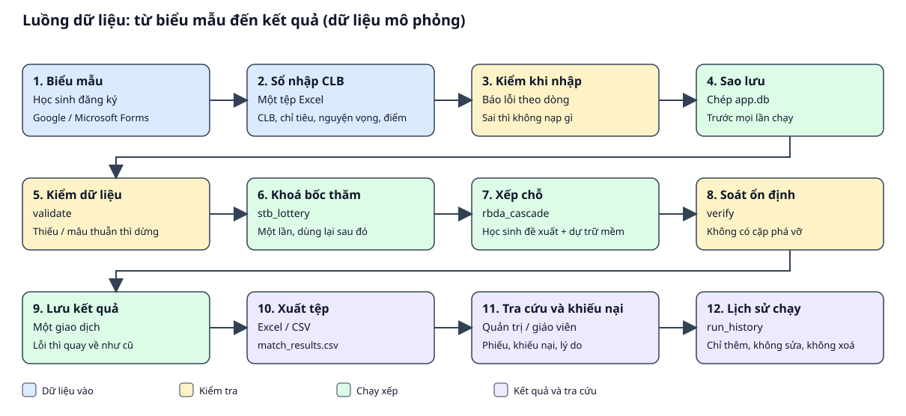

# Sơ đồ luồng dữ liệu

> **Dữ liệu mô phỏng.** Sơ đồ mô tả đường đi của dữ liệu trong phần mềm; mọi ví dụ trong bộ tài liệu này dùng dữ liệu
> do máy sinh, không phải học sinh thật.

Tệp vẽ: `docs/giai_trinh/so_do_luong.svg`, dựng lại bằng `docs/giai_trinh/ve_so_do.py` (chỉ dùng thư viện chuẩn của Python).

## Từng bước: làm gì, nằm ở đâu, nếu hỏng thì sao

| Bước | Việc làm | Nằm ở | Khi có sự cố |
|---|---|---|---|
| 1. Biểu mẫu | Học sinh điền nguyện vọng, chọn CLB thi, làm bài thi trên Forms | `docs/BO_CAU_HOI_FORMS.md` | Phiếu trùng, mã sai dạng được báo khi xử lý tệp xuất |
| 2. Sổ nhập CLB | Gộp thành một tệp Excel: sheet CLB và sheet học sinh | `so_nhap.py`, `api_nhap.py` | Xem bước 3 |
| 3. Kiểm khi nhập | Đọc từng dòng, báo lỗi kèm số dòng; có lỗi thì **không nạp gì** | `api_nhap.py` (`xem_truoc_so_nhap`, `import_so_nhap`) | Bảng lỗi ở `DU_LIEU_DAU_VAO.md` mục 3 |
| 4. Sao lưu | Chép `app.db` thành `app.db.bak-<ngày giờ>` trước khi chạy | `api.py` (`_backup_db`) | Sao lưu lỗi được ghi vào phản hồi nhưng không chặn lần chạy; riêng khi CSDL đang bị tiến trình khác giữ thì dừng ngay (`csdl_dang_ban`) |
| 5. Kiểm dữ liệu | Thiếu hoặc mâu thuẫn thì dừng và nêu rõ học sinh nào | `api.py` (`run_pipeline`), bước `validate` | Chạy dừng, dữ liệu không đổi |
| 6. Khoá bốc thăm | Bốc thăm một lần để phá hoà; sau đó dùng lại đúng các số cũ | `rbda_priority_pipeline.py` (`generate_stb_lottery`) | Học sinh đến muộn chèn ngẫu nhiên, giữ thứ tự cũ của người khác |
| 7. Xếp chỗ | Học sinh đề xuất, CLB giữ tạm, có suất dự trữ mềm, hai tầng ưu tiên | `rbda_priority_pipeline.py` (`run_rbda`) | — |
| 8. Soát ổn định | Kiểm bằng chính hàm lựa chọn: không có cặp học sinh – CLB nào cùng muốn nhau hơn kết quả | `rbda_priority_pipeline.py` (`verify_stability`) | Có vấn đề thì lần chạy dừng trước khi ghi kết quả |
| 9. Lưu kết quả | Ghi `match_results` và `run_history` trong **một giao dịch** | `api.py` (`run_pipeline`), bước `write_results` | Lỗi giữa chừng thì quay về như trước khi chạy |
| 10. Xuất tệp | Excel kết quả, `match_results.csv`, bảng theo lớp | `api_xuat.py` | Chưa có kết quả thì từ chối xuất |
| 11. Tra cứu, khiếu nại | Xem kết quả từng học sinh, nhận và xử lý khiếu nại, nhập thêm sau khi có kết quả; giải thích từng học sinh, phiếu in và tra cứu tại kiosk (sau tích hợp) | `api_sau_xep.py`, `api_bao_cao.py` | Khiếu nại quá hạn bị từ chối, nêu số ngày |
| 12. Lịch sử chạy | Mỗi lần chạy thêm một dòng `run_history`; không sửa, không xoá | `rbda_priority_pipeline.py` | — |

## Thứ tự cố định của một lần chạy

Sao lưu → kiểm dữ liệu → khoá bốc thăm → xếp chỗ → soát ổn định → ghi trong một giao dịch → xuất tệp. Tên các bước hiện trong
phản hồi của `run_pipeline` là `backup`, `validate`, `stb_lottery`, `rbda_cascade`, `write_results`, `export`; đã chạy thật trên sổ mẫu
120 học sinh và thấy đúng thứ tự này (xem `HUONG_DAN_CHAY.md`).

## Việc nằm ngoài luồng xếp

- **Tài khoản và quyền** (quản trị, giáo viên) và **nhật ký thao tác**: mọi lời gọi đi qua một cổng kiểm quyền ở `phan_quyen.py`;
  mỗi thao tác ghi một dòng vào `nhat_ky_thao_tac`. Các chức năng này không đọc, không đổi thứ tự ưu tiên. Xem `HUONG_DAN_CHAY.md`
  mục 8.
- **Tính tái lập:** cùng sổ nhập, cùng hạt giống thì cùng kết quả (`VAI_TRO_AI.md` mục 1).
