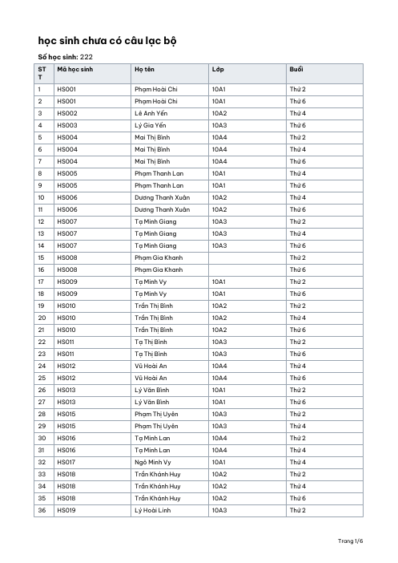
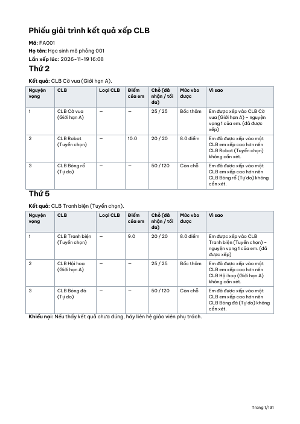
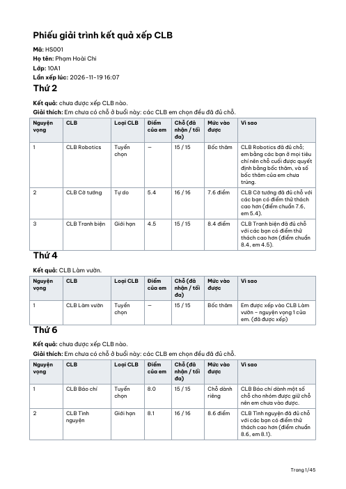

# XP1 — Đánh giá cuối từ góc người dùng (lead, 2026-11-19)

> Dữ liệu MÔ PHỎNG (`du_lieu_test/`), seed 3. Đây là ghi chép vận hành của nhóm lập trình, không phải kết luận cho
> báo cáo khoa học của học sinh. Cách chạy: app thật trong Chromium (`browser_host`), vai quản trị, bấm menu thật.

## Bộ dữ liệu
- `SO_NHAP_MAU_120HS_3BUOI.xlsx` (120 em, 3 buổi). Tệp mẫu KHÔNG có lớp và KHÔNG có loại CLB, nên lead gán thử
  lớp 10A1 đến 10A4 (một em để trống lớp) và loại CLB ngẫu nhiên để đọc được phiếu như giáo viên chủ nhiệm.
- `SO_NHAP_FA_MAU_120HS.xlsx` (120 em, chế độ FA), để nguyên.
- `SO_NHAP_DQT_800HS_HOP_LE.xlsx` (800 em, 27 lớp gán thử) cho số đo thời gian (`tests/test_xp1_hieu_nang.py`).

## Mục tiêu và số đo
| Mục tiêu | Kết quả | Đạt? |
|---|---|---|
| Mỗi kiểu xuất một thao tác | 3 lần bấm mỗi kiểu (thẻ Xuất dữ liệu → mở "Xuất PDF…" → mục), không lỗi trang | Đạt |
| Phiếu một em (thẻ tra cứu) ≤ 4 bước | 3 bước (tìm → chọn → Lưu PDF), có test Chromium | Đạt |
| 800 em, phiếu theo lớp < 30 s (CI Linux) | Máy lead 15,3 s (28 tệp, 1519 trang); một tệp 17,1 s; CI Linux không đo độ phủ: qua | Đạt |
| Danh sách 800 em | Theo CLB 2,8 s (21 tệp, 132 trang); theo lớp 0,9 s (28 tệp, 55 trang) | Đạt |
| Chữ tiếng Việt có dấu | Đọc đúng trên mọi trang đã mở (phông Be Vietnam Pro nhúng) | Đạt |
| Mỗi em sang trang mới, không lẫn dữ liệu em khác | Đúng trên 10A1 (45 trang / 30 em); checker kiểm thêm bằng test | Đạt |
| Danh sách không có điểm, số bốc thăm, thứ hạng | Không thấy trên các tệp đã mở; test khẳng định | Đạt |
| Loại CLB trên mọi dòng phiếu | Có khi `clubs.loai` có giá trị; tệp mẫu để trống nên hiện "—" | Đạt một phần |
| Tên tệp | `10A1.pdf`, `clb_robotics_thu_2.pdf`, `_chua_co_lop.pdf`, `_chua_duoc_xep.pdf`; xuất lại ra "x (2)" | Đạt |

## Vấn đề chính
1. **Đã sửa trong lượt này (FIX3).** Cột STT quá hẹp ("S/T/T", "2/0"); tệp `_chua_duoc_xep.pdf` ghi "Số học sinh:
   222" (là số lượt em × buổi, chỉ có 112 em); tiêu đề viết thường. Ảnh trước khi sửa:
   
2. **Tệp mẫu không có lớp và loại CLB.** Với hai Sổ nhập mẫu, xuất theo lớp dồn hết vào `_chua_co_lop.pdf` và cột
   "Loại CLB" chỉ có "—" (ở mẫu FA, loại chỉ nằm trong tên CLB "(Giới hạn A)"). Người thử app lần đầu sẽ thấy
   tính năng "trống". Ảnh (mẫu FA):
   
3. **Phiếu dài.** Dữ liệu 3 buổi cho khoảng 1,5 đến 1,9 trang mỗi em (800 em = 1519 trang). In cả trường tốn
   giấy; cột "Vì sao" chiếm nhiều dòng. Ảnh trang phiếu có loại CLB:
   
4. Nhỏ: thư mục xuất hiện trước khi ghi xong mọi tệp (lead thấy một tệp `.tmp` khi mở thư mục giữa chừng);
   tiêu đề "Chưa có câu lạc bộ" sát ngay dưới bảng trong tệp theo lớp; CLB không có em nào thì không có tệp.
5. Chưa kiểm được: bản .exe Windows (workflow build ghi đè bản phát hành công khai, xem "Needs Truong").

## Khuyến nghị (cho Truong quyết)
- Thêm cột lớp và loại CLB vào hai Sổ nhập mẫu trong `du_lieu_test/` (dữ liệu mô phỏng) để bản demo đầy đủ.
- Cân nhắc kiểu phiếu gọn (một dòng mỗi nguyện vọng, "Vì sao" rút ngắn) khi in cả trường.
- Ghi tệp vào thư mục tạm rồi đổi tên cả thư mục khi xong, để không ai mở thấy thư mục dở.
- Cho phép `pypdf` làm thư viện chỉ dùng cho test, để CI kiểm được chữ có dấu và quyền riêng tư trong PDF.
- Chạy build Windows sau khi gộp vào `main` rồi thử xuất PDF trên máy không mạng.
