# DG1 — Đánh giá định lượng thuật toán phân bổ RB-DA trên dữ liệu mô phỏng

> ⚠ **Toàn bộ số liệu đo trên DỮ LIỆU MÔ PHỎNG, không phải khảo sát học sinh thật.** Bộ sinh dữ liệu: `du_lieu_test/danh_gia/_sinh.py`, `mo_phong_fa_daa.py` và các bộ mẫu trong `du_lieu_test/`.
>
> Mọi con số trong tệp này do `du_lieu_test/danh_gia/viet_bao_cao.py` đọc từ `du_lieu_test/danh_gia/ket_qua/*.json`; không số nào gõ tay. Nguồn gốc từng JSON (commit, lệnh, thời gian): `du_lieu_test/danh_gia/ket_qua/README_LAN_CHAY.md` và mục 9.
>
> **Phân công viết** (quy định liêm chính của dự án): các mục đánh dấu ✍ (0, phần động cơ ở 1, 2, 6, 7, 8) do **học sinh** viết; AI chỉ soạn phần mô tả cơ chế, phương pháp, bảng/hình với chú thích mô tả, và cách tái lập.

## 0. Tóm tắt ✍

<!-- HS:tom_tat BẮT ĐẦU — phần học sinh viết; script sinh lại KHÔNG ghi đè -->
> ✍ *Phần học sinh tự viết. (Để trống.)*
<!-- HS:tom_tat KẾT THÚC -->

## 1. Đặt vấn đề và câu hỏi nghiên cứu

### 1.1 Động cơ ✍

<!-- HS:dong_co BẮT ĐẦU — phần học sinh viết; script sinh lại KHÔNG ghi đè -->
> ✍ *Phần học sinh tự viết. (Để trống.)*
<!-- HS:dong_co KẾT THÚC -->

### 1.2 Câu hỏi nghiên cứu

- **Q1.** Nguyện vọng của học sinh được đáp ứng đến mức nào, khi đặt cạnh các cơ chế đối chứng (Boston, thứ tự bốc thăm, TTC, DA do CLB đề xuất)?
- **Q2.** Những em nào chưa được xếp, và phần chưa xếp đó do dữ liệu (không thể tránh) hay do ưu tiên + ổn định?
- **Q3.** Chỉ tiêu các CLB và suất dự trữ được dùng đến mức nào?
- **Q4.** Khi đổi MỘT tiêu chí (suất dự trữ, cách xếp nhóm, phạm vi điểm, số nguyện vọng tối đa, chỉ tiêu), các chỉ số Q1–Q3 thay đổi bao nhiêu và bao nhiêu em đổi CLB? Các tính năng suất dự trữ, điểm quyết tâm, huy chương thay đổi gì khi bật/tắt?
- **Q5.** Các chỉ số Q1–Q3 thay đổi thế nào khi mức cạnh tranh (α) và tổng chỉ tiêu (κ) thay đổi, và khi trường lớn lên (thời gian chạy)?

## 2. Giả thuyết ✍

> Ghi chú về trình tự (sự kiện): lần chạy đầy đủ bắt đầu lúc 2026-11-28 03:02:25 (commit `d428f0851c`). Nếu mục này được viết SAU thời điểm đó, học sinh ghi rõ «giả thuyết viết sau khi đã có số liệu».

<!-- HS:gia_thuyet BẮT ĐẦU — phần học sinh viết; script sinh lại KHÔNG ghi đè -->
> ✍ *Phần học sinh tự viết. (Để trống.)*
<!-- HS:gia_thuyet KẾT THÚC -->

## 3. Cơ chế RB-DA (tóm tắt)

Mô tả đầy đủ: `docs/CO_CHE_THUAT_TOAN.md`. Tóm tắt các thành phần mà phần đo dùng tới:

1. **Chấp nhận hoãn, học sinh đề xuất** (Gale & Shapley, 1962): mỗi vòng, em chưa có chỗ nộp vào CLB kế tiếp trong danh sách; CLB giữ tạm những em xếp cao nhất theo thứ tự ưu tiên của mình, trả lại phần dư; lặp đến khi không còn ai nộp.
2. **Suất dự trữ mềm hai lượt** (Kominers & Sönmez, 2016): ở CLB có suất dự trữ, lượt 1 lấp suất dự trữ bằng em thuộc diện (`chinh_sach`, `khoi_10`), lượt 2 lấp suất thường bằng mọi em còn lại; suất dự trữ không ai dùng được chuyển sang suất thường.
3. **Thứ tự ưu tiên hai tầng**: CLB tuyển chọn (có thi) xếp theo điểm giảm dần rồi số bốc thăm; CLB không thi xếp theo số bốc thăm.
4. **Một lần bốc thăm chung (STB)** cho mọi CLB; số bốc thăm sinh bằng `crc32`, khoá sau lần chạy đầu.
5. **Kiểm sau giải**: `verify_stability` đếm cặp phá vỡ (một em và một CLB cùng muốn đổi sang nhau theo hàm lựa chọn thật).

Thứ tự ưu tiên không đọc thứ hạng nguyện vọng và không đọc kết quả lần chạy trước (bất biến 2 của dự án).

## 4. Phương pháp

### 4.1 Bộ sinh dữ liệu mô phỏng

Độ thích của học sinh *i* với CLB *j*: u(i, j) = α·pop(j) + (1 − α)·ε(i, j), ε ~ U(0, 1); pop(j) sinh một lần mỗi trường, giảm tuyến tính 1 → 0. Danh sách nguyện vọng = 3–6 CLB có u cao nhất (độ dài đều). α = 0: mọi em thích những CLB khác nhau; α = 0,9: gần như mọi em thích cùng các CLB.

| Tham số | Giá trị |
|---|---|
| α (mức trùng sở thích) | 0,00, 0,25, 0,50, 0,75, 0,90 |
| κ = Σ chỉ tiêu / số HS | 0,9, 1,1, 1,3 |
| ρ (điểm thi liên quan năng lực) | 0,0, 0,7 — điểm = round(10·(rho·nang_luc + (1−rho)·nhieu), 1) |
| Quy mô (HS × CLB) | 120 × 10, 300 × 10, 800 × 20; thời gian thêm 2000 × 50 |
| Cấu hình mặc định | 800 HS × 20 CLB, α = 0,50, ρ = 0,7, κ = 1,1 |
| Tỉ lệ CLB tuyển chọn (có thi) | 30 % |
| Xác suất em đăng ký thi một CLB tuyển chọn trong danh sách | 85 %, tối đa 5 bài |
| Diện dự trữ | chinh_sach 15 %, khoi_10 6 % |
| Suất dự trữ | 10 % chỉ tiêu ở 4 CLB được thích nhất |
| Chia chỉ tiêu | (pop + san_pop) × U(0,8; 1,2), largest remainder, tối thiểu 2 |
| Hạt giống ngẫu nhiên | random.Random(crc32(khoá)) |

### 4.2 Lưới hạt giống và khoảng tin cậy

Hai nguồn ngẫu nhiên tách riêng: **seed dữ liệu** = một trường mô phỏng khác (101, 102, 103, 104, 105); **seed bốc thăm** = cùng trường, lần bốc thăm khác (1, 2, 3, 4, 5, 6, 7, 8, 9, 10). Mỗi cấu hình: 5 trường × 10 lần bốc thăm. KTC 95 % kiểu t trên trung bình theo TRƯỜNG (n = số seed dữ liệu, bậc tự do n−1, t_{0,975} = 2.776); sd_boc_tham = trung bình độ lệch chuẩn giữa các lần bốc thăm trong cùng một trường.

### 4.3 Cơ chế đối chứng và cận trên

- **Boston** (chấp nhận ngay), **thứ tự bốc thăm (RSD)**, **TTC** (chu trình giao dịch hàng đầu), **DA do CLB đề xuất**: `du_lieu_test/co_che_doi_chung.py`; cả bốn gọi đúng hàm lựa chọn `club_choice_function` của phần mềm.
- **Cận trên** = kích thước ghép cực đại trên đồ thị (học sinh × CLB em đã liệt kê, sức chứa CLB), bỏ qua ưu tiên và ổn định (`_chi_so.py`, đường tăng). Số em mà không cơ chế nào trên cùng danh sách xếp được = N − cận trên.
- **Biến thể tiêu chí**: cùng dữ liệu, cùng seed bốc thăm, đổi đúng một tham số so với mặc định.

### 4.4 Định nghĩa chỉ số

| Nhóm | Chỉ số | Công thức | Mẫu số |
|---|---|---|---|
| A | Tỉ lệ được nguyện vọng 1 | #(em được xếp ở nguyện vọng 1) / #học sinh | mọi học sinh (kể cả danh sách rỗng, chưa được xếp) |
| A | Tỉ lệ nguyện vọng 1 trên em được xếp | #(nguyện vọng 1) / #(em được xếp) | em được xếp |
| A | Đường cong tích luỹ | phần tử k = #(em được xếp ở nguyện vọng ≤ k) / #học sinh, k = 1..K | mọi học sinh; K = độ dài danh sách dài nhất |
| A | Hạng nguyện vọng trung bình | trung bình hạng (1 = nguyện vọng đầu) của em được xếp | em được xếp |
| A | Xếp ngoài danh sách | #(em được xếp vào CLB không có trong danh sách của em); phải = 0 | — |
| A | Cặp phá vỡ (blocking pair) | số cặp (em, CLB) em thích hơn và CLB nhận em theo hàm lựa chọn thật; RB-DA phải = 0 | — |
| B | Tỉ lệ chưa được xếp | #(em chưa được xếp) / #học sinh | mọi học sinh |
| B | Cận trên: ghép cực đại | kích thước ghép cực đại đồ thị (học sinh × CLB đã liệt kê, sức chứa CLB), BỎ QUA ưu tiên và ổn định | — |
| B | Không thể tránh (do dữ liệu) | #học sinh − cận trên | — |
| B | Cái giá của ưu tiên + ổn định | cận trên − #(em được xếp) | — |
| B | Nguyên nhân chưa xếp (loại trừ nhau, theo thứ tự) | danh_sach_rong: danh sách rỗng; khong_diem: có ≥1 CLB tuyển chọn trong danh sách và em không có điểm ở CLB tuyển chọn nào đã khai; het_cho_uu_tien_cao_hon: còn lại (mọi CLB đã khai đều đầy người ưu tiên cao hơn) | em chưa được xếp |
| B | Tổng chỉ tiêu < số học sinh | Σ chỉ tiêu < #học sinh (cờ cho cả lần chạy) | — |
| B | Lệch chỗ | #(em chưa được xếp mà còn CLB em KHÔNG khai còn chỗ trống) | tính trên số em, không phải số CLB |
| C | Tỉ lệ lấp đầy | #(em được xếp) / Σ chỉ tiêu | tổng chỉ tiêu |
| C | Phân vị lấp đầy theo CLB | min, p25, trung vị, max của (đã xếp / chỉ tiêu) trên các CLB; nội suy tuyến tính | mỗi CLB |
| C | Suất dự trữ | đã dùng = #(em xếp với tầng 'reserve'); cung cấp = Σ reserve_capacity | Σ reserve_capacity |
| C | Tỉ lệ cầu | #(em xếp CLB này làm nguyện vọng 1) / chỉ tiêu CLB | chỉ tiêu CLB |

Thêm: «lật có chỗ» = % học sinh có lúc được xếp, có lúc không, giữa các lần bốc thăm của cùng một trường; «lật CLB» = % học sinh có CLB (hoặc 'không xếp') thay đổi giữa các lần bốc thăm của cùng một trường.

## 5. Kết quả

Quy ước: «tb [KTC 95 %]» = trung bình qua các trường mô phỏng và khoảng tin cậy t; «sd bốc» = độ lệch chuẩn giữa các lần bốc thăm trong một trường. Ở n = 5 trường, KTC của tỉ lệ có thể vượt ra ngoài [0; 100].

### 5.0 Đối chiếu với số liệu đã kiểm chứng

*Bảng 1: bộ TEST, seed 42, so với `SO_LIEU_DA_KIEM_CHUNG.md` §2; «Đo» chạy qua `run_pipeline` thật và qua lõi trong bộ nhớ.*

| Đại lượng | Đo | Mong đợi |
|---|---|---|
| Được xếp (run_pipeline) | 108 | 108 / 120 |
| Nguyện vọng 1 (run_pipeline) | 64 | 64 |
| Được xếp / NV1 (lõi trong bộ nhớ) | 108 / 64 | 108 / 64 |
| Khớp từng dòng match_results | True | True |
| Cặp phá vỡ | 0 | 0 |

*Nguồn: commit `17af13a152`, lệnh `python du_lieu_test/danh_gia/do_danh_gia.py --day-du --phan co_san nhieu_buoi`, 0.3 giây, 5 trường × 10 lần bốc thăm. Dữ liệu MÔ PHỎNG.*

### 5.1 Q1 — Mức đáp ứng nguyện vọng

*Bảng 2: cấu hình mặc định, mọi chỉ số A–C, 5 trường × 10 lần bốc thăm.*

| Chỉ số | tb [KTC 95 %] | sd bốc |
|---|---|---|
| % được NV1 (mẫu số: mọi học sinh) | 34,1 [31,9; 36,2] | 1,05 |
| % trong top 2 (mọi HS) | 55,5 [53,6; 57,3] | 0,96 |
| % trong top 3 (mọi HS) | 70,4 [69,0; 71,9] | 0,82 |
| % NV1 (mẫu số: em được xếp) | 40,6 [38,2; 43,0] | 1,29 |
| Hạng nguyện vọng trung bình (em được xếp) | 2,18 [2,12; 2,23] | 0,03 |
| Xếp ngoài danh sách (số em) | 0,0 [0,0; 0,0] | 0,00 |
| Cặp phá vỡ | 0,0 [0,0; 0,0] | 0,00 |
| Số em chưa được xếp | 128,8 [119,6; 138,0] | 4,76 |
| % chưa được xếp (mọi HS) | 16,1 [15,0; 17,2] | 0,60 |
| Cận trên: ghép cực đại | 769,2 [762,9; 775,5] | 0,00 |
| Không thể tránh (N − cận trên) | 30,8 [24,5; 37,1] | 0,00 |
| Giá của ưu tiên + ổn định (cận − được xếp) | 98,0 [91,4; 104,6] | 4,76 |
| Lệch chỗ (số em) | 128,8 [119,6; 138,0] | 4,76 |
| Chưa xếp: danh sách rỗng | 0,0 [0,0; 0,0] | 0,00 |
| Chưa xếp: không điểm ở CLB tuyển chọn | 11,7 [5,2; 18,2] | 2,22 |
| Chưa xếp: hết chỗ (người ưu tiên cao hơn) | 117,1 [105,1; 129,0] | 4,42 |
| % lấp đầy (đã xếp / Σ chỉ tiêu) | 76,3 [75,2; 77,3] | 0,54 |
| Lấp đầy CLB: min | 0,00 [0,00; 0,00] | 0,00 |
| Lấp đầy CLB: trung vị | 0,82 [0,79; 0,84] | 0,04 |
| Số CLB đầy | 9,8 [9,5; 10,2] | 0,19 |
| Số CLB lấp đầy < 50 % | 8,5 [7,9; 9,1] | 0,41 |
| Suất dự trữ cung cấp | 29,2 [27,2; 31,2] | 0,00 |
| Suất dự trữ đã dùng | 29,2 [27,2; 31,2] | 0,00 |
| Em diện dự trữ vào qua suất dự trữ | 29,2 [27,2; 31,2] | 0,00 |
| Em diện dự trữ vào qua suất thường | 9,5 [7,2; 11,9] | 2,72 |
| Số vòng thuật toán | 14,2 [12,5; 15,8] | 1,61 |

**Đường cong tích luỹ** (% HS được xếp ở nguyện vọng ≤ k, mẫu số: mọi HS)

| k | 1 | 2 | 3 | 4 | 5 | 6 |
|---|---|---|---|---|---|---|
| tb [KTC 95 %] | 34,1 [31,9; 36,2] | 55,5 [53,6; 57,3] | 70,4 [69,0; 71,9] | 78,3 [76,9; 79,6] | 82,5 [81,4; 83,7] | 83,9 [82,8; 85,0] |

**Nhóm** (% NV1, mẫu số: HS của nhóm; tb qua các trường)

| Nhóm | % NV1 | % chưa xếp = 100 − % được xếp |
|---|---|---|
| tang.tang_1 | 34,3 [32,1; 36,6] | 15,0 |
| tang.tang_2 | 30,7 [27,5; 34,0] | 21,4 |
| du_tru.chinh_sach | 34,5 [30,7; 38,3] | 16,2 |
| du_tru.khoi_10 | 37,9 [33,3; 42,5] | 11,5 |
| du_tru.khong | 33,7 [31,2; 36,2] | 16,4 |
| khoi.10 | 34,9 [31,8; 38,0] | 15,5 |
| khoi.11 | 33,2 [30,3; 36,1] | 16,6 |
| khoi.12 | 34,1 [31,8; 36,5] | 16,2 |

**Độ ổn định giữa các lần bốc thăm**: HS có lúc được xếp, có lúc không = 40,1 [34,1; 46,1] % ; HS đổi CLB = 80,2 [66,1; 94,2] %

**Theo CLB (trường mô phỏng đầu tiên, seed dữ liệu 101)**

| CLB | Chỉ tiêu | NV1 | Tỉ lệ cầu | Đã xếp tb | Lấp đầy |
|---|---|---|---|---|---|
| clb01 | 58 | 27 | 0,47 | 58,0 | 1,000 |
| clb02 | 19 | 0 | 0,00 | 0,0 | 0,000 |
| clb03 | 33 | 0 | 0,00 | 3,2 | 0,097 |
| clb04 | 70 | 62 | 0,89 | 70,0 | 1,000 |
| clb05 | 42 | 8 | 0,19 | 42,0 | 1,000 |
| clb06 | 81 | 261 | 3,22 | 81,0 | 1,000 |
| clb07 | 49 | 41 | 0,84 | 49,0 | 1,000 |
| clb08 | 31 | 0 | 0,00 | 10,1 | 0,326 |
| clb09 | 67 | 86 | 1,28 | 67,0 | 1,000 |
| clb10 | 26 | 0 | 0,00 | 0,0 | 0,000 |
| clb11 | 19 | 0 | 0,00 | 0,0 | 0,000 |
| clb12 | 49 | 9 | 0,18 | 49,0 | 1,000 |
| clb13 | 12 | 0 | 0,00 | 0,0 | 0,000 |
| clb14 | 44 | 0 | 0,00 | 20,2 | 0,459 |
| clb15 | 39 | 3 | 0,08 | 39,0 | 1,000 |
| clb16 | 15 | 0 | 0,00 | 0,0 | 0,000 |
| clb17 | 29 | 0 | 0,00 | 2,9 | 0,100 |
| clb18 | 42 | 2 | 0,05 | 25,3 | 0,602 |
| clb19 | 73 | 131 | 1,79 | 73,0 | 1,000 |
| clb20 | 82 | 170 | 2,07 | 82,0 | 1,000 |

(5 trường; bảng theo CLB chỉ in trường đầu)

*Nguồn: commit `d428f0851c`, lệnh `python du_lieu_test/danh_gia/do_danh_gia.py --day-du --phan doi_chieu mac_dinh co_che bien_the quet nhieu_buoi co_san`, 14.4 giây, 5 trường × 10 lần bốc thăm. Dữ liệu MÔ PHỎNG.*

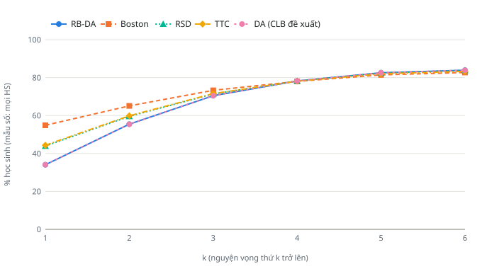

*Hình 1: đường cong tích luỹ — % học sinh (mẫu số: mọi HS) được xếp ở nguyện vọng ≤ k, năm cơ chế, cấu hình mặc định, trung bình 5 trường × 10 lần bốc thăm.*

*Bảng 3: năm cơ chế trên cùng dữ liệu và cùng seed bốc thăm, cấu hình mặc định.*

| Cơ chế | % NV1 | % top 3 | Hạng TB | Chưa xếp | Cận − xếp | % lấp đầy | Cặp phá vỡ |
|---|---|---|---|---|---|---|---|
| RB-DA | 34,1 [31,9; 36,2] | 70,4 [69,0; 71,9] | 2,18 [2,12; 2,23] | 128,8 [119,6; 138,0] | 98,0 [91,4; 104,6] | 76,3 [75,2; 77,3] | 0,0 [0,0; 0,0] |
| Boston | 54,9 [51,5; 58,2] | 73,3 [71,7; 74,9] | 1,74 [1,66; 1,82] | 138,4 [128,7; 148,0] | 107,6 [100,6; 114,6] | 75,2 [74,1; 76,3] | 452,9 [447,3; 458,6] |
| Thứ tự bốc thăm (RSD) | 43,9 [40,0; 47,8] | 71,4 [69,8; 72,9] | 2,00 [1,91; 2,08] | 129,3 [120,8; 137,8] | 98,5 [93,1; 103,9] | 76,2 [75,2; 77,2] | 461,3 [254,5; 668,0] |
| TTC | 44,3 [40,8; 47,9] | 71,5 [70,1; 72,9] | 1,97 [1,89; 2,05] | 133,7 [125,4; 141,9] | 102,9 [97,7; 108,1] | 75,7 [74,8; 76,6] | 1.047,1 [1.000,1; 1.094,1] |
| DA do CLB đề xuất | 34,1 [31,9; 36,2] | 70,4 [69,0; 71,9] | 2,18 [2,12; 2,23] | 128,8 [119,6; 138,0] | 98,0 [91,4; 104,6] | 76,3 [75,2; 77,3] | 0,0 [0,0; 0,0] |

*Suất dự trữ dùng (tang) chỉ có ở RB-DA; các cơ chế đối chứng đều gọi `club_choice_function` thật nhưng không ghi tầng. Cặp phá vỡ: RB-DA qua `verify_stability`; cơ chế khác qua cùng vòng lặp với `cc.thong_ke`.*

*Nguồn: commit `d428f0851c`, lệnh `python du_lieu_test/danh_gia/do_danh_gia.py --day-du --phan doi_chieu mac_dinh co_che bien_the quet nhieu_buoi co_san`, 104.9 giây, 5 trường × 10 lần bốc thăm. Dữ liệu MÔ PHỎNG.*

### 5.2 Q2 — Học sinh chưa được xếp

Cấu hình mặc định (Bảng 2): chưa xếp = 128,8 [119,6; 138,0] em; cận trên = 769,2 [762,9; 775,5]; không thể tránh = 30,8 [24,5; 37,1]; phần chênh cận − được xếp = 98,0 [91,4; 104,6]. Phân theo nguyên nhân: hết chỗ (người ưu tiên cao hơn) 117,1 [105,1; 129,0], không điểm ở CLB tuyển chọn 11,7 [5,2; 18,2], danh sách rỗng 0,0 [0,0; 0,0].

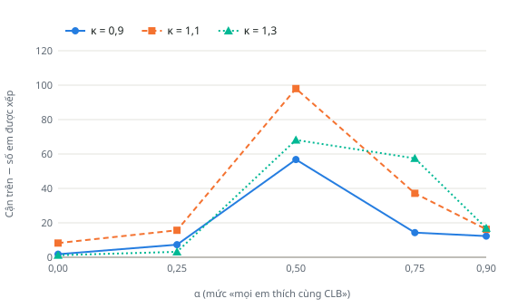

*Hình 5: phần chênh cận trên − số em được xếp (số em) theo α, ba mức κ; 800 HS × 20 CLB, ρ = 0,7; trung bình 5 trường.*

### 5.3 Q3 — Sử dụng chỉ tiêu

Cấu hình mặc định (Bảng 2): lấp đầy 76,3 [75,2; 77,3] %; suất dự trữ đã dùng 29,2 [27,2; 31,2] / cung cấp 29,2 [27,2; 31,2]; số CLB đầy 9,8 [9,5; 10,2]; số CLB lấp đầy < 50 % 8,5 [7,9; 9,1].

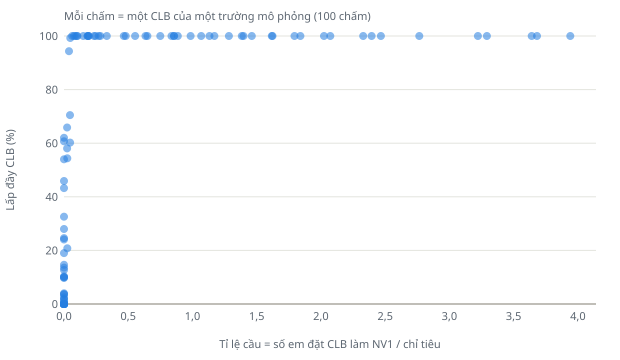

*Hình 3: lấp đầy của từng CLB (trục dọc, %) theo tỉ lệ cầu NV1 / chỉ tiêu (trục ngang); 5 trường mô phỏng cấu hình mặc định, lấp đầy trung bình qua 10 lần bốc thăm.*

### 5.4 Q4 — Đổi một tiêu chí; bật/tắt tính năng

*Bảng 4: chín biến thể so với mặc định, cùng dữ liệu và seed; «Lên hạng / Xuống hạng» = số em được xếp ở nguyện vọng có thứ hạng cao hơn / thấp hơn so với mặc định.*

| Biến thể | Thay đổi | Δ %NV1 | Δ %top3 | Δ chưa xếp (số em) | Δ %lấp đầy | Đổi CLB | Lên hạng | Xuống hạng | Cặp phá vỡ |
|---|---|---|---|---|---|---|---|---|---|
| du_tru_tat | Tắt toàn bộ suất dự trữ (reserve_capacity = 0) | 0,27 | 0,04 | -0,4 | 0,05 | 20,8 | 11,2 | 9,6 | 0 |
| nhom_cung | tier_mode = strict, tiers = [chinh_sach, khoi_10] (hạng nhóm trước điểm, bỏ suất dự trữ) | 5,09 | 0,16 | 0,5 | -0,06 | 231,1 | 111,5 | 119,6 | 0 |
| chi_nhom | priority = tier, tiers = [chinh_sach, khoi_10] (bỏ điểm, nhóm rồi bốc thăm) | 10,15 | 0,68 | 0,7 | -0,08 | 359,8 | 214,2 | 145,6 | 0 |
| diem_theo_nguoi | score_scope = per_person (điểm của em = trung bình điểm các bài em đã thi) | 8,50 | 1,10 | 5,2 | -0,59 | 408,6 | 243,8 | 164,8 | 0 |
| toi_da_3_nv | max_choices = 3 | 2,40 | 5,54 | 63,2 | -7,19 | 153,3 | 64,7 | 88,6 | 0 |
| toi_da_5_nv | max_choices = 5 | 0,13 | 0,33 | 7,3 | -0,84 | 16,0 | 5,5 | 10,5 | 0 |
| toi_da_10_nv | max_choices = 10 (danh sách mô phỏng ≤ 6 → phải GIỐNG HỆT mặc định) | 0,00 | 0,00 | 0,0 | 0,00 | 0,0 | 0,0 | 0,0 | 0 |
| chi_tieu_-20 | Chỉ tiêu mọi CLB × 0,8 | -8,57 | -13,50 | 95,5 | 5,50 | 210,6 | 0,0 | 210,6 | 0 |
| chi_tieu_+20 | Chỉ tiêu mọi CLB × 1,2 | 9,10 | 12,35 | -69,7 | -6,10 | 196,5 | 196,5 | 0,0 | 0 |

Mặc định: %NV1 = 34,1 [31,9; 36,2], %top3 = 70,4 [69,0; 71,9], chưa xếp = 128,8 [119,6; 138,0], %lấp đầy = 76,3 [75,2; 77,3].

Kiểm: max_choices=10 trùng mặc định = True; số em đổi CLB khớp `tieu_chi.so_sanh_lan_chay` (mẫu 1 cặp seed): True

*Nguồn: commit `d428f0851c`, lệnh `python du_lieu_test/danh_gia/do_danh_gia.py --day-du --phan doi_chieu mac_dinh co_che bien_the quet nhieu_buoi co_san`, 289.6 giây, 5 trường × 10 lần bốc thăm. Dữ liệu MÔ PHỎNG.*

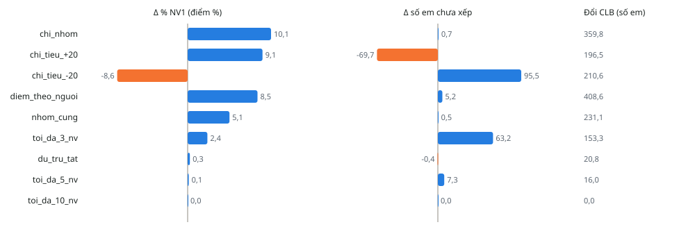

*Hình 4: thay đổi so với mặc định của % NV1 (điểm phần trăm) và số em chưa xếp, và số em đổi CLB, theo biến thể; xếp theo độ lớn |Δ % NV1|. Màu xanh = tăng, cam = giảm.*

*Bảng 5: tính năng suất dự trữ × điểm quyết tâm (lưới 2×2) và huy chương (FA-DAA) so với chế độ cũ, theo quy mô, α và hành vi khai.*

**120 HS × 10 CLB, α = 0,00** (hồ sơ điểm: 0 lỗi)

| Ô | % NV1 | % top 3 | Hạng TB | Chưa xếp | Dự trữ dùng | % vào CLB điểm cao nhất | Cặp phá vỡ |
|---|---|---|---|---|---|---|---|
| tắt / tắt | 75,9 [67,0; 84,8] | 97,4 [95,6; 99,2] | 1,32 [1,18; 1,47] | 1,2 [0,3; 2,2] | 0,0 [0,0; 0,0] | 53,6 [48,7; 58,5] | 0,0 [0,0; 0,0] |
| dự trữ bật | 75,8 [66,9; 84,8] | 97,3 [95,4; 99,2] | 1,32 [1,18; 1,47] | 1,3 [0,4; 2,2] | 4,7 [2,9; 6,5] | 53,6 [48,8; 58,5] | 0,0 [0,0; 0,0] |
| điểm quyết tâm bật | 77,4 [68,4; 86,3] | 97,2 [95,3; 99,1] | 1,32 [1,18; 1,47] | 0,5 [-0,3; 1,3] | 0,0 [0,0; 0,0] | 59,3 [53,4; 65,2] | 0,0 [0,0; 0,0] |
| cả hai bật | 77,4 [68,4; 86,3] | 97,2 [95,3; 99,1] | 1,32 [1,18; 1,47] | 0,5 [-0,3; 1,3] | 5,0 [3,8; 6,2] | 59,3 [53,4; 65,2] | 0,0 [0,0; 0,0] |

Theo nhóm dự trữ, bật − tắt dự trữ (có cặp theo trường): Δ %NV1 / Δ hạng TB / Δ % được xếp (mẫu số: HS của nhóm)

| Nhóm | Δ %NV1 | Δ hạng TB | Δ % được xếp |
|---|---|---|---|
| chinh_sach | 0,00 [0,00; 0,00] | -0,001 [-0,002; 0,001] | -0,11 [-0,42; 0,20] |
| khoi_10 | 0,57 [-1,01; 2,14] | -0,019 [-0,054; 0,017] | 0,29 [-0,51; 1,08] |
| khong | -0,14 [-0,48; 0,19] | 0,002 [-0,002; 0,005] | -0,06 [-0,17; 0,05] |

Số em đổi CLB khi bật dự trữ (tb mỗi lần chạy): chinh_sach: đổi 0,02, lên hạng 0,00, xuống hạng 0,02; khoi_10: đổi 0,16, lên hạng 0,16, xuống hạng 0,00; khong: đổi 0,14, lên hạng 0,00, xuống hạng 0,14

**120 HS × 10 CLB, α = 0,50** (hồ sơ điểm: 0 lỗi)

| Ô | % NV1 | % top 3 | Hạng TB | Chưa xếp | Dự trữ dùng | % vào CLB điểm cao nhất | Cặp phá vỡ |
|---|---|---|---|---|---|---|---|
| tắt / tắt | 47,9 [40,8; 55,0] | 86,5 [83,8; 89,1] | 1,85 [1,76; 1,94] | 5,8 [4,0; 7,6] | 0,0 [0,0; 0,0] | 44,3 [40,1; 48,5] | 0,0 [0,0; 0,0] |
| dự trữ bật | 47,6 [40,7; 54,5] | 86,5 [83,9; 89,1] | 1,86 [1,75; 1,97] | 5,6 [3,9; 7,4] | 7,0 [6,2; 7,9] | 43,9 [40,2; 47,6] | 0,0 [0,0; 0,0] |
| điểm quyết tâm bật | 50,8 [40,2; 61,3] | 87,1 [84,0; 90,2] | 1,86 [1,76; 1,96] | 3,7 [0,7; 6,8] | 0,0 [0,0; 0,0] | 55,6 [51,8; 59,5] | 0,0 [0,0; 0,0] |
| cả hai bật | 50,4 [40,3; 60,5] | 87,1 [84,1; 90,0] | 1,86 [1,76; 1,97] | 3,6 [0,4; 6,7] | 6,9 [5,6; 8,2] | 55,6 [51,8; 59,3] | 0,0 [0,0; 0,0] |

Theo nhóm dự trữ, bật − tắt dự trữ (có cặp theo trường): Δ %NV1 / Δ hạng TB / Δ % được xếp (mẫu số: HS của nhóm)

| Nhóm | Δ %NV1 | Δ hạng TB | Δ % được xếp |
|---|---|---|---|
| chinh_sach | -0,11 [-2,37; 2,16] | 0,021 [-0,024; 0,067] | 0,00 [-0,48; 0,48] |
| khoi_10 | 10,84 [-5,90; 27,59] | -0,296 [-0,624; 0,031] | 3,72 [-3,98; 11,42] |
| khong | -1,12 [-2,12; -0,11] | 0,028 [-0,005; 0,061] | -0,11 [-0,57; 0,35] |

Số em đổi CLB khi bật dự trữ (tb mỗi lần chạy): chinh_sach: đổi 0,74, lên hạng 0,28, xuống hạng 0,46; khoi_10: đổi 1,58, lên hạng 1,56, xuống hạng 0,02; khong: đổi 3,38, lên hạng 0,88, xuống hạng 2,50

**120 HS × 10 CLB, α = 0,90** (hồ sơ điểm: 0 lỗi)

| Ô | % NV1 | % top 3 | Hạng TB | Chưa xếp | Dự trữ dùng | % vào CLB điểm cao nhất | Cặp phá vỡ |
|---|---|---|---|---|---|---|---|
| tắt / tắt | 16,8 [14,8; 18,9] | 50,5 [48,0; 53,0] | 2,91 [2,85; 2,97] | 26,9 [25,7; 28,0] | 0,0 [0,0; 0,0] | 22,6 [20,6; 24,7] | 0,0 [0,0; 0,0] |
| dự trữ bật | 16,8 [14,8; 18,9] | 50,5 [48,0; 53,0] | 2,91 [2,85; 2,97] | 26,9 [25,7; 28,0] | 7,4 [6,8; 7,9] | 22,6 [20,4; 24,7] | 0,0 [0,0; 0,0] |
| điểm quyết tâm bật | 16,8 [14,8; 18,9] | 50,5 [48,0; 53,0] | 3,01 [2,94; 3,08] | 23,8 [22,2; 25,3] | 0,0 [0,0; 0,0] | 29,4 [21,0; 37,8] | 0,0 [0,0; 0,0] |
| cả hai bật | 16,8 [14,8; 18,9] | 50,5 [48,0; 53,0] | 3,01 [2,95; 3,07] | 23,7 [22,1; 25,3] | 7,5 [6,9; 8,1] | 29,4 [21,1; 37,7] | 0,0 [0,0; 0,0] |

Theo nhóm dự trữ, bật − tắt dự trữ (có cặp theo trường): Δ %NV1 / Δ hạng TB / Δ % được xếp (mẫu số: HS của nhóm)

| Nhóm | Δ %NV1 | Δ hạng TB | Δ % được xếp |
|---|---|---|---|
| chinh_sach | 1,65 [-1,04; 4,34] | -0,014 [-0,061; 0,034] | 0,23 [-0,38; 0,84] |
| khoi_10 | 0,00 [0,00; 0,00] | -0,174 [-0,256; -0,093] | 4,57 [0,73; 8,41] |
| khong | -0,33 [-0,87; 0,21] | 0,015 [0,010; 0,020] | -0,40 [-0,64; -0,17] |

Số em đổi CLB khi bật dự trữ (tb mỗi lần chạy): chinh_sach: đổi 0,90, lên hạng 0,54, xuống hạng 0,36; khoi_10: đổi 1,30, lên hạng 1,30, xuống hạng 0,00; khong: đổi 2,10, lên hạng 0,34, xuống hạng 1,76

**300 HS × 10 CLB, α = 0,00** (hồ sơ điểm: 0 lỗi)

| Ô | % NV1 | % top 3 | Hạng TB | Chưa xếp | Dự trữ dùng | % vào CLB điểm cao nhất | Cặp phá vỡ |
|---|---|---|---|---|---|---|---|
| tắt / tắt | 73,2 [65,1; 81,2] | 96,7 [94,5; 98,8] | 1,37 [1,24; 1,50] | 3,6 [0,7; 6,4] | 0,0 [0,0; 0,0] | 54,6 [51,8; 57,4] | 0,0 [0,0; 0,0] |
| dự trữ bật | 73,2 [65,2; 81,2] | 96,7 [94,5; 98,8] | 1,37 [1,24; 1,50] | 3,6 [0,7; 6,4] | 14,4 [11,6; 17,3] | 54,6 [51,6; 57,5] | 0,0 [0,0; 0,0] |
| điểm quyết tâm bật | 75,9 [70,2; 81,7] | 96,3 [93,6; 99,0] | 1,35 [1,24; 1,47] | 3,4 [0,3; 6,5] | 0,0 [0,0; 0,0] | 60,8 [58,1; 63,5] | 0,0 [0,0; 0,0] |
| cả hai bật | 76,0 [70,2; 81,8] | 96,3 [93,6; 99,1] | 1,35 [1,24; 1,47] | 3,4 [0,3; 6,5] | 14,8 [12,5; 17,1] | 60,9 [58,1; 63,7] | 0,0 [0,0; 0,0] |

Theo nhóm dự trữ, bật − tắt dự trữ (có cặp theo trường): Δ %NV1 / Δ hạng TB / Δ % được xếp (mẫu số: HS của nhóm)

| Nhóm | Δ %NV1 | Δ hạng TB | Δ % được xếp |
|---|---|---|---|
| chinh_sach | 0,14 [-0,56; 0,83] | -0,007 [-0,024; 0,010] | -0,04 [-0,17; 0,08] |
| khoi_10 | 1,78 [-0,59; 4,14] | -0,014 [-0,043; 0,015] | 0,78 [-0,95; 2,52] |
| khong | -0,13 [-0,28; 0,02] | 0,003 [-0,000; 0,005] | -0,05 [-0,16; 0,06] |

Số em đổi CLB khi bật dự trữ (tb mỗi lần chạy): chinh_sach: đổi 0,34, lên hạng 0,22, xuống hạng 0,12; khoi_10: đổi 0,48, lên hạng 0,44, xuống hạng 0,04; khong: đổi 1,02, lên hạng 0,24, xuống hạng 0,78

**300 HS × 10 CLB, α = 0,50** (hồ sơ điểm: 0 lỗi)

| Ô | % NV1 | % top 3 | Hạng TB | Chưa xếp | Dự trữ dùng | % vào CLB điểm cao nhất | Cặp phá vỡ |
|---|---|---|---|---|---|---|---|
| tắt / tắt | 47,8 [40,8; 54,8] | 85,2 [82,6; 87,8] | 1,89 [1,78; 1,99] | 16,7 [13,3; 20,2] | 0,0 [0,0; 0,0] | 40,5 [34,6; 46,3] | 0,0 [0,0; 0,0] |
| dự trữ bật | 47,8 [40,9; 54,7] | 85,1 [82,4; 87,9] | 1,89 [1,78; 1,99] | 16,9 [13,0; 20,8] | 19,2 [18,0; 20,3] | 40,3 [34,5; 46,0] | 0,0 [0,0; 0,0] |
| điểm quyết tâm bật | 53,0 [45,8; 60,1] | 84,0 [80,6; 87,5] | 1,90 [1,81; 2,00] | 10,3 [4,9; 15,8] | 0,0 [0,0; 0,0] | 54,3 [46,6; 62,1] | 0,0 [0,0; 0,0] |
| cả hai bật | 52,9 [46,3; 59,5] | 83,8 [80,4; 87,2] | 1,91 [1,81; 2,00] | 11,0 [5,9; 16,1] | 19,4 [18,3; 20,5] | 54,4 [46,6; 62,2] | 0,0 [0,0; 0,0] |

Theo nhóm dự trữ, bật − tắt dự trữ (có cặp theo trường): Δ %NV1 / Δ hạng TB / Δ % được xếp (mẫu số: HS của nhóm)

| Nhóm | Δ %NV1 | Δ hạng TB | Δ % được xếp |
|---|---|---|---|
| chinh_sach | -0,13 [-0,77; 0,51] | 0,011 [0,005; 0,017] | -0,18 [-0,41; 0,06] |
| khoi_10 | 10,99 [5,07; 16,91] | -0,272 [-0,358; -0,187] | 2,23 [-0,17; 4,62] |
| khong | -0,84 [-1,52; -0,16] | 0,021 [0,006; 0,036] | -0,21 [-0,39; -0,02] |

Số em đổi CLB khi bật dự trữ (tb mỗi lần chạy): chinh_sach: đổi 1,00, lên hạng 0,28, xuống hạng 0,72; khoi_10: đổi 3,66, lên hạng 3,62, xuống hạng 0,04; khong: đổi 5,44, lên hạng 0,74, xuống hạng 4,70

**300 HS × 10 CLB, α = 0,90** (hồ sơ điểm: 0 lỗi)

| Ô | % NV1 | % top 3 | Hạng TB | Chưa xếp | Dự trữ dùng | % vào CLB điểm cao nhất | Cặp phá vỡ |
|---|---|---|---|---|---|---|---|
| tắt / tắt | 18,6 [15,8; 21,5] | 51,5 [49,5; 53,5] | 2,81 [2,75; 2,86] | 64,0 [61,2; 66,8] | 0,0 [0,0; 0,0] | 24,4 [22,3; 26,5] | 0,0 [0,0; 0,0] |
| dự trữ bật | 18,6 [15,8; 21,5] | 51,5 [49,5; 53,5] | 2,81 [2,75; 2,86] | 64,0 [61,0; 67,0] | 19,3 [18,7; 20,0] | 24,3 [22,3; 26,3] | 0,0 [0,0; 0,0] |
| điểm quyết tâm bật | 18,6 [15,8; 21,5] | 51,5 [49,5; 53,5] | 2,89 [2,81; 2,98] | 57,1 [50,5; 63,7] | 0,0 [0,0; 0,0] | 36,1 [29,6; 42,6] | 0,0 [0,0; 0,0] |
| cả hai bật | 18,6 [15,8; 21,5] | 51,5 [49,5; 53,5] | 2,90 [2,81; 2,99] | 56,7 [50,0; 63,5] | 19,5 [18,9; 20,2] | 36,0 [29,4; 42,5] | 0,0 [0,0; 0,0] |

Theo nhóm dự trữ, bật − tắt dự trữ (có cặp theo trường): Δ %NV1 / Δ hạng TB / Δ % được xếp (mẫu số: HS của nhóm)

| Nhóm | Δ %NV1 | Δ hạng TB | Δ % được xếp |
|---|---|---|---|
| chinh_sach | 0,31 [-0,01; 0,63] | 0,014 [-0,002; 0,030] | -0,18 [-0,77; 0,42] |
| khoi_10 | 0,00 [0,00; 0,00] | -0,238 [-0,335; -0,141] | 6,23 [2,31; 10,14] |
| khong | -0,06 [-0,11; -0,00] | 0,017 [0,011; 0,022] | -0,43 [-0,63; -0,24] |

Số em đổi CLB khi bật dự trữ (tb mỗi lần chạy): chinh_sach: đổi 1,22, lên hạng 0,38, xuống hạng 0,84; khoi_10: đổi 4,20, lên hạng 4,20, xuống hạng 0,00; khong: đổi 4,66, lên hạng 0,30, xuống hạng 4,36

**800 HS × 20 CLB, α = 0,00** (hồ sơ điểm: 0 lỗi)

| Ô | % NV1 | % top 3 | Hạng TB | Chưa xếp | Dự trữ dùng | % vào CLB điểm cao nhất | Cặp phá vỡ |
|---|---|---|---|---|---|---|---|
| tắt / tắt | 75,4 [72,6; 78,3] | 97,2 [96,3; 98,0] | 1,33 [1,28; 1,38] | 8,3 [4,9; 11,6] | 0,0 [0,0; 0,0] | 54,7 [51,3; 58,1] | 0,0 [0,0; 0,0] |
| dự trữ bật | 75,4 [72,6; 78,3] | 97,2 [96,3; 98,0] | 1,33 [1,28; 1,38] | 8,3 [4,9; 11,6] | 18,8 [16,6; 21,0] | 54,7 [51,3; 58,1] | 0,0 [0,0; 0,0] |
| điểm quyết tâm bật | 77,2 [74,4; 80,0] | 96,7 [95,7; 97,6] | 1,33 [1,28; 1,38] | 6,5 [0,8; 12,2] | 0,0 [0,0; 0,0] | 59,8 [55,7; 63,9] | 0,0 [0,0; 0,0] |
| cả hai bật | 77,2 [74,4; 80,0] | 96,7 [95,7; 97,6] | 1,33 [1,28; 1,38] | 6,5 [0,8; 12,2] | 18,8 [16,2; 21,3] | 59,8 [55,7; 63,9] | 0,0 [0,0; 0,0] |

Theo nhóm dự trữ, bật − tắt dự trữ (có cặp theo trường): Δ %NV1 / Δ hạng TB / Δ % được xếp (mẫu số: HS của nhóm)

| Nhóm | Δ %NV1 | Δ hạng TB | Δ % được xếp |
|---|---|---|---|
| chinh_sach | 0,00 [0,00; 0,00] | 0,000 [0,000; 0,000] | 0,00 [0,00; 0,00] |
| khoi_10 | 0,00 [0,00; 0,00] | 0,000 [0,000; 0,000] | 0,00 [0,00; 0,00] |
| khong | 0,00 [0,00; 0,00] | 0,000 [0,000; 0,000] | 0,00 [0,00; 0,00] |

Số em đổi CLB khi bật dự trữ (tb mỗi lần chạy): chinh_sach: đổi 0,00, lên hạng 0,00, xuống hạng 0,00; khoi_10: đổi 0,00, lên hạng 0,00, xuống hạng 0,00; khong: đổi 0,00, lên hạng 0,00, xuống hạng 0,00

**800 HS × 20 CLB, α = 0,50** (hồ sơ điểm: 0 lỗi)

| Ô | % NV1 | % top 3 | Hạng TB | Chưa xếp | Dự trữ dùng | % vào CLB điểm cao nhất | Cặp phá vỡ |
|---|---|---|---|---|---|---|---|
| tắt / tắt | 34,3 [32,1; 36,6] | 70,5 [69,1; 71,9] | 2,17 [2,12; 2,23] | 128,4 [119,1; 137,7] | 0,0 [0,0; 0,0] | 35,8 [31,8; 39,7] | 0,0 [0,0; 0,0] |
| dự trữ bật | 34,1 [31,9; 36,2] | 70,4 [69,0; 71,9] | 2,18 [2,12; 2,23] | 128,8 [119,6; 138,0] | 29,2 [27,2; 31,2] | 35,6 [31,8; 39,3] | 0,0 [0,0; 0,0] |
| điểm quyết tâm bật | 37,6 [36,2; 39,0] | 71,5 [70,9; 72,0] | 2,12 [2,10; 2,14] | 122,9 [116,6; 129,2] | 0,0 [0,0; 0,0] | 47,4 [43,6; 51,2] | 0,0 [0,0; 0,0] |
| cả hai bật | 37,5 [36,2; 38,9] | 71,4 [70,8; 72,0] | 2,12 [2,09; 2,16] | 123,5 [118,1; 128,9] | 29,2 [27,2; 31,2] | 47,3 [43,5; 51,0] | 0,0 [0,0; 0,0] |

Theo nhóm dự trữ, bật − tắt dự trữ (có cặp theo trường): Δ %NV1 / Δ hạng TB / Δ % được xếp (mẫu số: HS của nhóm)

| Nhóm | Δ %NV1 | Δ hạng TB | Δ % được xếp |
|---|---|---|---|
| chinh_sach | -0,80 [-1,42; -0,18] | 0,020 [0,001; 0,039] | -0,38 [-0,77; 0,01] |
| khoi_10 | 5,88 [3,40; 8,37] | -0,184 [-0,251; -0,118] | 3,92 [1,14; 6,70] |
| khong | -0,63 [-1,14; -0,12] | 0,016 [0,005; 0,027] | -0,30 [-0,53; -0,07] |

Số em đổi CLB khi bật dự trữ (tb mỗi lần chạy): chinh_sach: đổi 2,44, lên hạng 0,38, xuống hạng 2,06; khoi_10: đổi 7,40, lên hạng 7,22, xuống hạng 0,18; khong: đổi 10,98, lên hạng 2,00, xuống hạng 8,98

**800 HS × 20 CLB, α = 0,90** (hồ sơ điểm: 0 lỗi)

| Ô | % NV1 | % top 3 | Hạng TB | Chưa xếp | Dự trữ dùng | % vào CLB điểm cao nhất | Cặp phá vỡ |
|---|---|---|---|---|---|---|---|
| tắt / tắt | 11,5 [9,4; 13,6] | 29,2 [26,1; 32,3] | 3,26 [3,12; 3,40] | 380,5 [364,3; 396,7] | 0,0 [0,0; 0,0] | 22,4 [17,9; 26,9] | 0,0 [0,0; 0,0] |
| dự trữ bật | 11,5 [9,4; 13,6] | 29,2 [26,0; 32,4] | 3,26 [3,12; 3,40] | 380,5 [364,3; 396,6] | 28,4 [26,5; 30,3] | 22,4 [17,9; 26,9] | 0,0 [0,0; 0,0] |
| điểm quyết tâm bật | 15,9 [10,9; 20,9] | 29,4 [25,9; 33,0] | 3,18 [3,08; 3,28] | 377,3 [360,0; 394,5] | 0,0 [0,0; 0,0] | 36,8 [24,4; 49,3] | 0,0 [0,0; 0,0] |
| cả hai bật | 15,7 [10,8; 20,6] | 29,4 [25,9; 32,9] | 3,18 [3,08; 3,28] | 377,2 [360,1; 394,4] | 28,4 [26,5; 30,3] | 36,5 [23,9; 49,2] | 0,0 [0,0; 0,0] |

Theo nhóm dự trữ, bật − tắt dự trữ (có cặp theo trường): Δ %NV1 / Δ hạng TB / Δ % được xếp (mẫu số: HS của nhóm)

| Nhóm | Δ %NV1 | Δ hạng TB | Δ % được xếp |
|---|---|---|---|
| chinh_sach | 0,12 [-0,13; 0,37] | 0,010 [-0,004; 0,025] | -0,20 [-0,38; -0,03] |
| khoi_10 | 1,00 [0,58; 1,42] | -0,220 [-0,317; -0,122] | 5,41 [3,73; 7,09] |
| khong | -0,10 [-0,12; -0,07] | 0,016 [0,006; 0,025] | -0,37 [-0,50; -0,23] |

Số em đổi CLB khi bật dự trữ (tb mỗi lần chạy): chinh_sach: đổi 1,84, lên hạng 0,58, xuống hạng 1,26; khoi_10: đổi 7,48, lên hạng 7,44, xuống hạng 0,04; khong: đổi 9,04, lên hạng 1,00, xuống hạng 8,04

#### Tính năng: huy chương (FA-DAA) so với chế độ cũ (mô hình `mo_phong_fa_daa`)

**120 học sinh** (mẫu số: em × buổi; «thật» = theo độ thích thật, không theo cách em khai)

| Hành vi | % NV1 thật (cũ) | % NV1 thật (FA) | % không CLB (cũ) | % không CLB (FA) | % vào CLB vàng (FA, trên có CLB) | % thua bốc thăm (FA) | Đổi / lên hạng / xuống hạng (em×buổi mỗi lần chạy) |
|---|---|---|---|---|---|---|---|
| luoi | 16,0 [12,5; 19,4] | 34,2 [15,5; 53,0] | 36,1 [32,9; 39,3] | 0,0 [0,0; 0,0] | 10,4 [-0,1; 20,8] | 65,8 [19,9; 111,7] | 52,3 / 46,3 / 6,0 |
| that_tha | 22,2 [15,6; 28,9] | 55,0 [37,3; 72,7] | 20,9 [17,0; 24,8] | 0,0 [0,0; 0,0] | 25,8 [10,1; 41,5] | 36,2 [14,8; 57,6] | 60,2 / 56,5 / 3,7 |
| chien_luoc | 21,5 [19,7; 23,2] | 37,6 [12,0; 63,2] | 23,3 [17,2; 29,4] | 0,0 [0,0; 0,0] | 6,8 [-1,3; 14,9] | 40,4 [-3,8; 84,6] | 28,6 / 24,5 / 4,1 |

Lý do quyết định (% dòng): ACCEPTED|ACCEPTED = 48,9; FALLBACK|HET_NGUYEN_VONG = 2,7; REJECTED|LOTTERY = 14,6; REJECTED|MEDAL = 6,1; REJECTED|SCORE = 11,3; REMOVED|BELOW_PASS = 16,5

**300 học sinh** (mẫu số: em × buổi; «thật» = theo độ thích thật, không theo cách em khai)

| Hành vi | % NV1 thật (cũ) | % NV1 thật (FA) | % không CLB (cũ) | % không CLB (FA) | % vào CLB vàng (FA, trên có CLB) | % thua bốc thăm (FA) | Đổi / lên hạng / xuống hạng (em×buổi mỗi lần chạy) |
|---|---|---|---|---|---|---|---|
| luoi | 17,2 [13,6; 20,8] | 37,0 [19,2; 54,8] | 34,6 [30,0; 39,2] | 0,0 [0,0; 0,0] | 11,5 [1,2; 21,7] | 66,3 [20,2; 112,3] | 118,3 / 105,2 / 13,1 |
| that_tha | 21,7 [16,3; 27,1] | 54,1 [37,5; 70,6] | 22,9 [20,1; 25,8] | 0,0 [0,0; 0,0] | 25,0 [10,6; 39,4] | 38,2 [15,6; 60,9] | 165,2 / 154,9 / 10,3 |
| chien_luoc | 21,8 [18,4; 25,2] | 37,6 [17,4; 57,8] | 23,8 [19,2; 28,4] | 0,0 [0,0; 0,0] | 10,3 [-1,2; 21,8] | 42,4 [1,9; 82,8] | 72,8 / 61,7 / 11,1 |

Lý do quyết định (% dòng): ACCEPTED|ACCEPTED = 48,5; FALLBACK|HET_NGUYEN_VONG = 2,7; REJECTED|LOTTERY = 14,6; REJECTED|MEDAL = 6,0; REJECTED|SCORE = 12,2; REMOVED|BELOW_PASS = 16,0

**800 học sinh** (mẫu số: em × buổi; «thật» = theo độ thích thật, không theo cách em khai)

| Hành vi | % NV1 thật (cũ) | % NV1 thật (FA) | % không CLB (cũ) | % không CLB (FA) | % vào CLB vàng (FA, trên có CLB) | % thua bốc thăm (FA) | Đổi / lên hạng / xuống hạng (em×buổi mỗi lần chạy) |
|---|---|---|---|---|---|---|---|
| luoi | 17,2 [14,8; 19,6] | 36,0 [19,1; 52,9] | 34,2 [31,3; 37,2] | 0,0 [0,0; 0,0] | 11,9 [1,5; 22,2] | 65,9 [19,3; 112,5] | 298,2 / 265,1 / 33,2 |
| that_tha | 21,7 [17,1; 26,3] | 54,0 [37,4; 70,6] | 23,0 [21,1; 25,0] | 0,0 [0,0; 0,0] | 23,8 [9,9; 37,8] | 39,5 [15,7; 63,4] | 455,6 / 425,7 / 29,9 |
| chien_luoc | 21,6 [17,6; 25,5] | 39,5 [16,4; 62,6] | 22,9 [20,1; 25,6] | 0,0 [0,0; 0,0] | 10,0 [-1,6; 21,6] | 45,5 [-0,0; 90,9] | 188,1 / 160,7 / 27,4 |

Lý do quyết định (% dòng): ACCEPTED|ACCEPTED = 49,2; FALLBACK|HET_NGUYEN_VONG = 2,5; REJECTED|LOTTERY = 15,5; REJECTED|MEDAL = 4,7; REJECTED|SCORE = 12,5; REMOVED|BELOW_PASS = 15,6

*Nguồn: commit `d428f0851c`, lệnh `python du_lieu_test/danh_gia/do_tinh_nang.py --day-du`, 394.3 giây, 5 trường × 10 lần bốc thăm. Dữ liệu MÔ PHỎNG.*

### 5.5 Q5 — Mức cạnh tranh, quy mô và thời gian

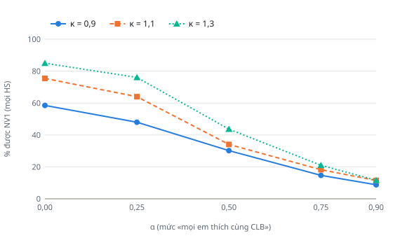

*Hình 2: % học sinh được NV1 (mẫu số: mọi HS) theo α, ba mức κ; 800 HS × 20 CLB, ρ = 0,7; trung bình 5 trường × 10 lần bốc thăm.*

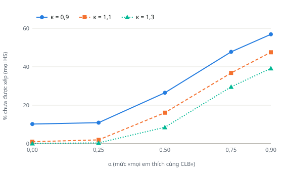

*Hình 2b: % học sinh chưa được xếp theo α, ba mức κ; cùng cấu hình với Hình 2.*

*Bảng 6: quét 3 quy mô × 5 α × 3 κ × 2 ρ = 90 cấu hình.*

**120 HS × 10 CLB, ρ = 0,0**

| α | κ | % NV1 | % top 3 | % chưa xếp | Cận − xếp | % lấp đầy | CLB < 50 % | Cặp phá vỡ |
|---|---|---|---|---|---|---|---|---|
| 0,00 | 0,9 | 51,0 [47,2; 54,8] | 83,0 [82,0; 84,1] | 10,0 [10,0; 10,1] | 0,0 [-0,0; 0,1] | 100,0 [99,9; 100,0] | 0,0 [0,0; 0,0] | 0 |
| 0,00 | 1,1 | 74,5 [68,8; 80,1] | 97,2 [95,4; 99,0] | 1,1 [0,6; 1,7] | 1,3 [0,7; 2,0] | 89,9 [89,4; 90,4] | 0,0 [0,0; 0,0] | 0 |
| 0,00 | 1,3 | 80,0 [76,4; 83,5] | 99,1 [97,9; 100,4] | 0,1 [-0,0; 0,2] | 0,1 [-0,0; 0,3] | 76,8 [76,7; 76,9] | 0,7 [0,1; 1,3] | 0 |
| 0,25 | 0,9 | 57,1 [50,0; 64,3] | 83,8 [82,7; 84,9] | 10,1 [9,9; 10,3] | 0,2 [-0,1; 0,4] | 99,9 [99,6; 100,1] | 0,0 [0,0; 0,0] | 0 |
| 0,25 | 1,1 | 79,6 [73,1; 86,1] | 99,0 [98,2; 99,8] | 0,3 [-0,0; 0,6] | 0,4 [-0,0; 0,7] | 90,6 [90,4; 90,9] | 0,5 [-0,3; 1,3] | 0 |
| 0,25 | 1,3 | 89,6 [84,2; 95,0] | 99,8 [99,4; 100,3] | 0,0 [-0,1; 0,1] | 0,0 [-0,1; 0,2] | 76,9 [76,8; 76,9] | 2,9 [2,1; 3,7] | 0 |
| 0,50 | 0,9 | 37,1 [28,8; 45,5] | 69,5 [66,1; 72,8] | 15,2 [12,9; 17,5] | 5,6 [2,3; 9,0] | 94,2 [91,7; 96,8] | 1,4 [0,8; 2,0] | 0 |
| 0,50 | 1,1 | 49,7 [43,3; 56,1] | 85,1 [80,4; 89,7] | 4,6 [3,5; 5,8] | 5,5 [4,1; 6,9] | 86,7 [85,7; 87,8] | 2,8 [2,2; 3,5] | 0 |
| 0,50 | 1,3 | 55,7 [50,6; 60,8] | 93,9 [91,2; 96,7] | 1,7 [1,0; 2,4] | 2,0 [1,2; 2,9] | 75,6 [75,1; 76,1] | 4,3 [3,9; 4,6] | 0 |
| 0,75 | 0,9 | 21,2 [15,8; 26,6] | 46,5 [44,6; 48,3] | 27,5 [26,3; 28,6] | 6,6 [5,1; 8,0] | 80,6 [79,3; 81,9] | 3,8 [3,6; 4,1] | 0 |
| 0,75 | 1,1 | 24,7 [20,9; 28,6] | 60,1 [56,2; 64,0] | 17,0 [13,6; 20,4] | 11,2 [8,8; 13,6] | 75,5 [72,3; 78,6] | 4,4 [4,0; 4,7] | 0 |
| 0,75 | 1,3 | 29,7 [21,7; 37,6] | 67,0 [64,2; 69,9] | 11,1 [9,0; 13,2] | 13,3 [10,8; 15,9] | 68,4 [66,7; 70,0] | 4,9 [4,7; 5,1] | 0 |
| 0,90 | 0,9 | 16,2 [14,3; 18,0] | 42,8 [41,9; 43,8] | 31,9 [30,5; 33,3] | 4,3 [2,9; 5,7] | 75,7 [74,1; 77,2] | 4,4 [4,0; 4,7] | 0 |
| 0,90 | 1,1 | 19,7 [17,1; 22,3] | 52,0 [49,2; 54,8] | 21,7 [19,8; 23,6] | 9,7 [7,8; 11,5] | 71,2 [69,4; 72,9] | 5,0 [4,9; 5,0] | 0 |
| 0,90 | 1,3 | 21,8 [19,8; 23,9] | 60,7 [59,8; 61,5] | 15,0 [13,8; 16,1] | 17,9 [16,6; 19,3] | 65,4 [64,6; 66,3] | 5,3 [4,8; 5,7] | 0 |

**120 HS × 10 CLB, ρ = 0,7**

| α | κ | % NV1 | % top 3 | % chưa xếp | Cận − xếp | % lấp đầy | CLB < 50 % | Cặp phá vỡ |
|---|---|---|---|---|---|---|---|---|
| 0,00 | 0,9 | 56,5 [51,6; 61,3] | 83,6 [82,7; 84,5] | 10,3 [10,0; 10,5] | 0,3 [-0,0; 0,6] | 99,7 [99,4; 100,0] | 0,0 [0,0; 0,0] | 0 |
| 0,00 | 1,1 | 75,8 [66,9; 84,8] | 97,3 [95,4; 99,2] | 1,1 [0,3; 1,9] | 1,3 [0,4; 2,2] | 89,9 [89,2; 90,6] | 0,0 [0,0; 0,0] | 0 |
| 0,00 | 1,3 | 81,2 [75,4; 86,9] | 98,8 [97,6; 99,9] | 0,3 [0,0; 0,6] | 0,4 [0,0; 0,7] | 76,7 [76,5; 76,9] | 0,9 [0,3; 1,5] | 0 |
| 0,25 | 0,9 | 60,9 [57,1; 64,7] | 84,8 [84,1; 85,6] | 10,0 [10,0; 10,1] | 0,0 [-0,0; 0,1] | 100,0 [99,9; 100,0] | 0,0 [0,0; 0,0] | 0 |
| 0,25 | 1,1 | 85,2 [77,3; 93,1] | 99,4 [98,3; 100,4] | 0,3 [-0,1; 0,7] | 0,3 [-0,2; 0,8] | 90,7 [90,3; 91,0] | 0,7 [-0,0; 1,3] | 0 |
| 0,25 | 1,3 | 95,6 [93,7; 97,6] | 100,0 [100,0; 100,0] | 0,0 [0,0; 0,0] | 0,0 [0,0; 0,0] | 76,9 [76,9; 76,9] | 3,1 [2,4; 3,8] | 0 |
| 0,50 | 0,9 | 35,1 [31,4; 38,8] | 70,0 [66,9; 73,1] | 16,8 [15,0; 18,7] | 7,4 [4,5; 10,3] | 92,4 [90,4; 94,4] | 1,7 [1,1; 2,3] | 0 |
| 0,50 | 1,1 | 47,6 [40,7; 54,5] | 86,5 [83,9; 89,1] | 4,7 [3,2; 6,1] | 5,6 [3,9; 7,4] | 86,6 [85,3; 88,0] | 2,8 [2,5; 3,2] | 0 |
| 0,50 | 1,3 | 56,3 [54,8; 57,8] | 93,9 [89,8; 97,9] | 1,6 [0,1; 3,2] | 2,0 [0,1; 3,8] | 75,7 [74,5; 76,8] | 4,4 [3,8; 4,9] | 0 |
| 0,75 | 0,9 | 21,5 [15,6; 27,4] | 48,9 [47,9; 50,0] | 27,3 [26,0; 28,7] | 6,2 [4,8; 7,6] | 80,7 [79,2; 82,3] | 3,8 [3,6; 4,0] | 0 |
| 0,75 | 1,1 | 26,0 [22,1; 30,0] | 61,2 [59,4; 62,9] | 16,2 [15,1; 17,2] | 14,8 [11,8; 17,8] | 76,2 [75,2; 77,2] | 4,6 [4,4; 4,8] | 0 |
| 0,75 | 1,3 | 29,5 [24,6; 34,4] | 73,9 [71,5; 76,3] | 9,0 [8,4; 9,6] | 10,8 [10,1; 11,5] | 70,0 [69,5; 70,5] | 5,0 [5,0; 5,1] | 0 |
| 0,90 | 0,9 | 14,7 [12,8; 16,6] | 41,5 [39,5; 43,5] | 32,1 [30,0; 34,3] | 3,6 [1,8; 5,3] | 75,4 [73,0; 77,8] | 4,2 [4,0; 4,3] | 0 |
| 0,90 | 1,1 | 16,8 [14,8; 18,9] | 50,5 [48,0; 53,0] | 22,4 [21,4; 23,4] | 10,1 [7,9; 12,3] | 70,6 [69,7; 71,4] | 4,9 [4,8; 5,1] | 0 |
| 0,90 | 1,3 | 20,7 [19,0; 22,4] | 59,5 [54,9; 64,1] | 14,4 [12,2; 16,6] | 16,5 [13,6; 19,4] | 65,8 [64,1; 67,5] | 5,1 [4,9; 5,2] | 0 |

**300 HS × 10 CLB, ρ = 0,0**

| α | κ | % NV1 | % top 3 | % chưa xếp | Cận − xếp | % lấp đầy | CLB < 50 % | Cặp phá vỡ |
|---|---|---|---|---|---|---|---|---|
| 0,00 | 0,9 | 55,3 [51,2; 59,4] | 84,5 [83,1; 85,8] | 10,0 [10,0; 10,1] | 0,0 [-0,1; 0,2] | 100,0 [99,9; 100,0] | 0,0 [0,0; 0,0] | 0 |
| 0,00 | 1,1 | 75,5 [70,4; 80,6] | 97,7 [96,1; 99,4] | 0,7 [0,1; 1,2] | 2,0 [0,3; 3,7] | 90,3 [89,8; 90,8] | 0,0 [0,0; 0,0] | 0 |
| 0,00 | 1,3 | 85,6 [84,1; 87,1] | 99,1 [98,4; 99,9] | 0,3 [0,1; 0,6] | 1,0 [0,2; 1,8] | 76,7 [76,5; 76,9] | 0,6 [-0,1; 1,3] | 0 |
| 0,25 | 0,9 | 57,0 [50,2; 63,8] | 85,4 [85,0; 85,9] | 10,0 [10,0; 10,0] | 0,0 [0,0; 0,0] | 100,0 [100,0; 100,0] | 0,0 [0,0; 0,0] | 0 |
| 0,25 | 1,1 | 83,1 [79,4; 86,8] | 99,5 [99,2; 99,9] | 0,2 [0,1; 0,3] | 0,5 [0,2; 0,8] | 90,8 [90,7; 90,8] | 0,4 [-0,1; 0,9] | 0 |
| 0,25 | 1,3 | 95,2 [91,3; 99,1] | 100,0 [100,0; 100,0] | 0,0 [0,0; 0,0] | 0,0 [0,0; 0,0] | 76,9 [76,9; 76,9] | 3,0 [2,9; 3,2] | 0 |
| 0,50 | 0,9 | 37,6 [28,3; 47,0] | 69,4 [68,0; 70,7] | 14,7 [14,0; 15,4] | 14,1 [12,0; 16,2] | 94,8 [94,0; 95,6] | 1,3 [1,2; 1,4] | 0 |
| 0,50 | 1,1 | 43,3 [37,2; 49,4] | 84,8 [83,3; 86,3] | 6,0 [5,6; 6,4] | 18,0 [16,8; 19,2] | 85,5 [85,1; 85,8] | 3,3 [3,0; 3,7] | 0 |
| 0,50 | 1,3 | 56,8 [50,0; 63,6] | 94,8 [93,7; 96,0] | 1,4 [1,1; 1,7] | 4,1 [3,2; 5,1] | 75,9 [75,6; 76,1] | 4,3 [3,9; 4,8] | 0 |
| 0,75 | 0,9 | 20,0 [14,1; 26,0] | 46,8 [44,6; 48,9] | 27,8 [25,2; 30,4] | 14,6 [12,7; 16,5] | 80,2 [77,3; 83,1] | 4,0 [4,0; 4,0] | 0 |
| 0,75 | 1,1 | 27,7 [20,8; 34,7] | 58,3 [55,7; 61,0] | 17,8 [17,0; 18,5] | 33,2 [24,6; 41,8] | 74,8 [74,0; 75,5] | 4,5 [3,9; 5,0] | 0 |
| 0,75 | 1,3 | 29,1 [21,8; 36,4] | 68,8 [64,4; 73,1] | 9,9 [7,1; 12,7] | 29,7 [21,2; 38,1] | 69,3 [67,1; 71,5] | 5,0 [5,0; 5,0] | 0 |
| 0,90 | 0,9 | 15,3 [13,8; 16,9] | 41,4 [40,6; 42,2] | 30,8 [29,9; 31,6] | 6,9 [3,4; 10,3] | 76,9 [76,0; 77,9] | 4,0 [3,9; 4,2] | 0 |
| 0,90 | 1,1 | 18,8 [16,5; 21,0] | 50,7 [47,6; 53,7] | 21,7 [19,5; 23,9] | 23,4 [18,4; 28,4] | 71,2 [69,2; 73,2] | 5,0 [4,9; 5,0] | 0 |
| 0,90 | 1,3 | 22,2 [18,7; 25,7] | 62,3 [58,0; 66,6] | 14,1 [11,6; 16,5] | 42,2 [34,8; 49,5] | 66,1 [64,2; 68,0] | 5,3 [5,0; 5,7] | 0 |

**300 HS × 10 CLB, ρ = 0,7**

| α | κ | % NV1 | % top 3 | % chưa xếp | Cận − xếp | % lấp đầy | CLB < 50 % | Cặp phá vỡ |
|---|---|---|---|---|---|---|---|---|
| 0,00 | 0,9 | 53,6 [50,9; 56,4] | 83,8 [82,9; 84,8] | 10,0 [10,0; 10,0] | 0,0 [-0,0; 0,1] | 100,0 [100,0; 100,0] | 0,0 [0,0; 0,0] | 0 |
| 0,00 | 1,1 | 73,2 [65,2; 81,2] | 96,7 [94,5; 98,8] | 1,2 [0,2; 2,1] | 3,6 [0,7; 6,4] | 89,8 [89,0; 90,7] | 0,0 [0,0; 0,0] | 0 |
| 0,00 | 1,3 | 83,1 [78,9; 87,3] | 99,6 [99,3; 99,9] | 0,1 [-0,0; 0,2] | 0,3 [-0,1; 0,7] | 76,8 [76,7; 76,9] | 0,3 [-0,1; 0,6] | 0 |
| 0,25 | 0,9 | 59,6 [54,9; 64,3] | 85,2 [83,9; 86,4] | 10,0 [10,0; 10,0] | 0,0 [0,0; 0,0] | 100,0 [100,0; 100,0] | 0,0 [0,0; 0,0] | 0 |
| 0,25 | 1,1 | 88,7 [86,4; 90,9] | 99,5 [98,7; 100,3] | 0,2 [-0,1; 0,4] | 0,5 [-0,3; 1,2] | 90,8 [90,5; 91,0] | 0,6 [0,2; 1,0] | 0 |
| 0,25 | 1,3 | 96,0 [92,4; 99,6] | 100,0 [99,9; 100,0] | 0,0 [-0,0; 0,0] | 0,0 [-0,0; 0,1] | 76,9 [76,9; 76,9] | 2,9 [1,7; 4,1] | 0 |
| 0,50 | 0,9 | 39,8 [34,4; 45,2] | 70,0 [67,7; 72,4] | 15,2 [14,6; 15,8] | 15,2 [12,5; 17,8] | 94,2 [93,6; 94,9] | 1,3 [1,1; 1,5] | 0 |
| 0,50 | 1,1 | 47,8 [40,9; 54,7] | 85,1 [82,4; 87,9] | 5,6 [4,3; 6,9] | 16,9 [13,0; 20,8] | 85,8 [84,6; 87,0] | 3,0 [2,4; 3,6] | 0 |
| 0,50 | 1,3 | 56,6 [50,3; 62,9] | 93,9 [91,5; 96,3] | 1,9 [1,1; 2,7] | 5,6 [3,3; 8,0] | 75,5 [74,9; 76,1] | 4,6 [4,3; 4,9] | 0 |
| 0,75 | 0,9 | 23,0 [18,2; 27,8] | 48,2 [45,7; 50,7] | 27,0 [25,6; 28,4] | 15,4 [12,9; 17,9] | 81,1 [79,5; 82,7] | 3,9 [3,9; 4,0] | 0 |
| 0,75 | 1,1 | 26,0 [23,1; 28,9] | 59,7 [57,0; 62,4] | 16,9 [15,2; 18,6] | 36,3 [29,0; 43,6] | 75,6 [74,0; 77,2] | 4,6 [4,3; 5,0] | 0 |
| 0,75 | 1,3 | 28,1 [23,7; 32,5] | 70,1 [64,7; 75,6] | 10,5 [8,1; 12,9] | 31,6 [24,4; 38,8] | 68,8 [67,0; 70,7] | 5,0 [5,0; 5,1] | 0 |
| 0,90 | 0,9 | 16,0 [14,0; 18,0] | 42,5 [40,2; 44,9] | 31,9 [29,7; 34,2] | 7,0 [2,1; 11,9] | 75,6 [73,2; 78,1] | 4,0 [4,0; 4,0] | 0 |
| 0,90 | 1,1 | 18,6 [15,8; 21,5] | 51,5 [49,5; 53,5] | 21,3 [20,3; 22,3] | 26,6 [20,1; 33,0] | 71,5 [70,6; 72,4] | 5,0 [5,0; 5,0] | 0 |
| 0,90 | 1,3 | 22,4 [20,2; 24,6] | 62,9 [60,8; 64,9] | 13,6 [12,0; 15,2] | 40,8 [36,0; 45,6] | 66,5 [65,2; 67,7] | 5,1 [5,0; 5,1] | 0 |

**800 HS × 20 CLB, ρ = 0,0**

| α | κ | % NV1 | % top 3 | % chưa xếp | Cận − xếp | % lấp đầy | CLB < 50 % | Cặp phá vỡ |
|---|---|---|---|---|---|---|---|---|
| 0,00 | 0,9 | 55,9 [52,5; 59,2] | 84,7 [83,9; 85,6] | 10,0 [10,0; 10,0] | 0,0 [-0,0; 0,1] | 100,0 [100,0; 100,0] | 0,0 [0,0; 0,0] | 0 |
| 0,00 | 1,1 | 76,5 [71,2; 81,7] | 97,6 [96,2; 99,0] | 1,0 [0,4; 1,6] | 8,0 [3,4; 12,5] | 90,0 [89,5; 90,5] | 0,0 [0,0; 0,0] | 0 |
| 0,00 | 1,3 | 84,3 [82,2; 86,3] | 99,2 [98,7; 99,7] | 0,2 [0,0; 0,5] | 2,1 [0,4; 3,8] | 76,7 [76,5; 76,9] | 1,3 [0,8; 1,8] | 0 |
| 0,25 | 0,9 | 49,9 [47,5; 52,3] | 80,8 [80,2; 81,4] | 10,6 [10,3; 10,9] | 4,9 [2,8; 7,1] | 99,3 [99,0; 99,6] | 0,1 [-0,1; 0,2] | 0 |
| 0,25 | 1,1 | 63,1 [59,4; 66,8] | 94,3 [93,5; 95,1] | 2,1 [1,7; 2,5] | 16,4 [13,2; 19,5] | 89,1 [88,7; 89,4] | 3,9 [3,0; 4,7] | 0 |
| 0,25 | 1,3 | 78,8 [73,4; 84,3] | 99,2 [98,7; 99,6] | 0,3 [0,1; 0,4] | 2,2 [1,1; 3,4] | 76,7 [76,6; 76,8] | 8,2 [7,5; 8,9] | 0 |
| 0,50 | 0,9 | 28,1 [24,7; 31,5] | 57,2 [56,0; 58,3] | 27,2 [26,0; 28,5] | 55,7 [47,0; 64,4] | 80,9 [79,4; 82,3] | 7,3 [6,8; 7,8] | 0 |
| 0,50 | 1,1 | 36,6 [32,9; 40,3] | 69,0 [67,5; 70,5] | 16,3 [15,3; 17,4] | 92,7 [87,7; 97,8] | 76,1 [75,1; 77,0] | 8,6 [7,7; 9,5] | 0 |
| 0,50 | 1,3 | 45,6 [40,6; 50,6] | 81,5 [78,8; 84,2] | 7,9 [6,4; 9,4] | 63,3 [51,3; 75,4] | 70,8 [69,7; 72,0] | 9,5 [9,2; 9,9] | 0 |
| 0,75 | 0,9 | 12,5 [6,6; 18,3] | 31,9 [29,0; 34,8] | 47,4 [46,1; 48,7] | 18,1 [10,1; 26,0] | 58,4 [57,0; 59,9] | 11,8 [11,5; 12,2] | 0 |
| 0,75 | 1,1 | 19,7 [13,6; 25,8] | 41,4 [40,1; 42,7] | 37,6 [36,3; 38,9] | 36,3 [27,6; 45,0] | 56,7 [55,6; 57,9] | 12,3 [11,7; 12,8] | 0 |
| 0,75 | 1,3 | 19,5 [12,5; 26,5] | 47,2 [45,1; 49,2] | 29,4 [28,2; 30,6] | 54,4 [42,6; 66,1] | 54,3 [53,4; 55,2] | 12,8 [12,6; 13,0] | 0 |
| 0,90 | 0,9 | 8,9 [7,1; 10,8] | 23,2 [20,3; 26,1] | 57,0 [55,3; 58,7] | 13,7 [11,6; 15,8] | 47,8 [45,9; 49,7] | 13,9 [13,6; 14,1] | 0 |
| 0,90 | 1,1 | 11,5 [8,7; 14,3] | 30,5 [28,8; 32,2] | 47,2 [45,0; 49,3] | 16,2 [11,5; 21,0] | 48,0 [46,1; 50,0] | 14,0 [14,0; 14,0] | 0 |
| 0,90 | 1,3 | 14,0 [10,8; 17,3] | 34,7 [32,6; 36,9] | 39,5 [36,2; 42,9] | 24,6 [17,2; 31,9] | 46,5 [43,9; 49,1] | 14,0 [14,0; 14,0] | 0 |

**800 HS × 20 CLB, ρ = 0,7**

| α | κ | % NV1 | % top 3 | % chưa xếp | Cận − xếp | % lấp đầy | CLB < 50 % | Cặp phá vỡ |
|---|---|---|---|---|---|---|---|---|
| 0,00 | 0,9 | 58,5 [56,7; 60,4] | 84,8 [83,3; 86,3] | 10,2 [9,7; 10,8] | 1,8 [-2,5; 6,1] | 99,8 [99,2; 100,4] | 0,0 [0,0; 0,0] | 0 |
| 0,00 | 1,1 | 75,4 [72,6; 78,3] | 97,2 [96,3; 98,0] | 1,0 [0,6; 1,4] | 8,3 [4,9; 11,6] | 90,0 [89,6; 90,4] | 0,0 [0,0; 0,0] | 0 |
| 0,00 | 1,3 | 85,0 [82,1; 87,8] | 99,6 [99,4; 99,8] | 0,1 [-0,0; 0,3] | 1,2 [0,1; 2,3] | 76,8 [76,7; 76,9] | 0,3 [-0,3; 0,9] | 0 |
| 0,25 | 0,9 | 48,0 [45,2; 50,8] | 80,6 [79,7; 81,4] | 10,9 [10,3; 11,5] | 7,3 [2,4; 12,3] | 99,0 [98,3; 99,7] | 0,1 [-0,1; 0,2] | 0 |
| 0,25 | 1,1 | 64,0 [61,2; 66,7] | 94,7 [93,0; 96,4] | 2,0 [1,1; 2,8] | 15,7 [9,0; 22,4] | 89,1 [88,4; 89,9] | 4,0 [3,0; 4,9] | 0 |
| 0,25 | 1,3 | 76,1 [71,8; 80,3] | 98,9 [98,2; 99,6] | 0,4 [0,1; 0,7] | 3,1 [0,8; 5,5] | 76,6 [76,3; 76,8] | 8,2 [7,1; 9,4] | 0 |
| 0,50 | 0,9 | 30,2 [24,5; 35,8] | 57,5 [56,5; 58,6] | 26,5 [25,7; 27,2] | 56,8 [45,0; 68,6] | 81,7 [80,9; 82,5] | 7,6 [7,1; 8,1] | 0 |
| 0,50 | 1,1 | 34,1 [31,9; 36,2] | 70,4 [69,0; 71,9] | 16,1 [15,0; 17,2] | 98,0 [91,4; 104,6] | 76,3 [75,2; 77,3] | 8,5 [7,9; 9,1] | 0 |
| 0,50 | 1,3 | 43,7 [38,3; 49,0] | 80,7 [78,9; 82,4] | 8,5 [8,0; 9,1] | 68,1 [63,7; 72,5] | 70,4 [70,0; 70,8] | 10,0 [9,7; 10,4] | 0 |
| 0,75 | 0,9 | 14,7 [11,6; 17,8] | 34,0 [32,0; 36,0] | 47,8 [46,7; 48,8] | 14,3 [10,7; 17,9] | 58,0 [56,8; 59,2] | 12,0 [11,9; 12,0] | 0 |
| 0,75 | 1,1 | 18,2 [15,0; 21,4] | 42,9 [41,2; 44,7] | 36,8 [35,0; 38,6] | 37,1 [26,5; 47,8] | 57,5 [55,8; 59,1] | 12,3 [11,8; 12,8] | 0 |
| 0,75 | 1,3 | 21,0 [17,9; 24,1] | 49,4 [45,5; 53,2] | 29,6 [26,5; 32,6] | 57,5 [53,0; 62,0] | 54,2 [51,9; 56,5] | 13,0 [13,0; 13,0] | 0 |
| 0,90 | 0,9 | 8,8 [6,2; 11,3] | 23,5 [21,2; 25,8] | 56,9 [55,1; 58,7] | 12,3 [9,7; 14,9] | 47,9 [45,9; 49,9] | 14,0 [14,0; 14,0] | 0 |
| 0,90 | 1,1 | 11,5 [9,4; 13,6] | 29,2 [26,0; 32,4] | 47,6 [45,5; 49,6] | 16,3 [13,8; 18,8] | 47,7 [45,8; 49,5] | 14,0 [14,0; 14,0] | 0 |
| 0,90 | 1,3 | 11,6 [9,0; 14,1] | 33,5 [31,2; 35,9] | 39,2 [37,0; 41,3] | 16,9 [14,3; 19,5] | 46,8 [45,1; 48,5] | 14,0 [14,0; 14,0] | 0 |

*Nguồn: commit `d428f0851c`, lệnh `python du_lieu_test/danh_gia/do_danh_gia.py --day-du --phan doi_chieu mac_dinh co_che bien_the quet nhieu_buoi co_san`, 1162.7 giây, 5 trường × 10 lần bốc thăm. Dữ liệu MÔ PHỎNG.*

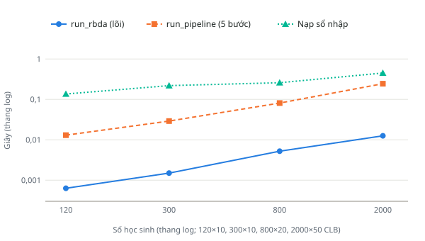

*Hình 6: thời gian chạy (trung vị 3 lần, giây, thang log) theo số học sinh: lõi `run_rbda`, `run_pipeline` 5 bước, nạp Sổ nhập. Thời gian CPU tường (perf_counter), máy ghi ở lan_chay.may; median của 3 lần.*

*Bảng 7: thời gian chạy.*

| HS × CLB | run_rbda (s) | Số vòng | Ghi sổ nhập (s) | Nạp sổ nhập (s) | run_pipeline 5 bước (s) |
|---|---|---|---|---|---|
| 120 × 10 | 0,0006 | 7 | 0,69 | 0,14 | 0,01 |
| 300 × 10 | 0,0015 | 12 | 0,63 | 0,22 | 0,03 |
| 800 × 20 | 0,0052 | 16 | 0,80 | 0,26 | 0,08 |
| 2000 × 50 | 0,0126 | 15 | 1,19 | 0,45 | 0,24 |

*Nguồn: commit `c209817a57`, lệnh `python du_lieu_test/danh_gia/do_danh_gia.py --day-du --phan thoi_gian`, 23.5 giây, 5 trường × 10 lần bốc thăm. Dữ liệu MÔ PHỎNG.*

*Bảng 8: 800 HS × 20 CLB × 3 buổi, cấu hình mặc định.*

| Buổi | % NV1 | % top 3 | % chưa xếp | % lấp đầy | Cặp phá vỡ |
|---|---|---|---|---|---|
| thu_2 | 56,8 [52,1; 61,6] | 96,1 [93,3; 98,9] | 0,9 [0,2; 1,6] | 83,8 [80,4; 87,1] | 0,0 [0,0; 0,0] |
| thu_4 | 54,1 [50,6; 57,6] | 91,2 [88,3; 94,0] | 2,3 [1,2; 3,5] | 89,5 [87,7; 91,3] | 0,0 [0,0; 0,0] |
| thu_6 | 56,3 [51,3; 61,3] | 91,9 [86,6; 97,1] | 2,8 [0,3; 5,4] | 95,0 [91,2; 98,8] | 0,0 [0,0; 0,0] |

**Theo học sinh (mọi buổi)**

| Chỉ số | tb [KTC 95 %] |
|---|---|
| n_hs | 800,00 [800,00; 800,00] |
| so_buoi_co_cho_tb | 2,94 [2,92; 2,96] |
| pct_du_moi_buoi_da_khai | 94,05 [92,35; 95,75] |
| pct_khong_co_cho_nao | 0,00 [0,00; 0,00] |

*Nguồn: commit `17af13a152`, lệnh `python du_lieu_test/danh_gia/do_danh_gia.py --day-du --phan co_san nhieu_buoi`, 12.9 giây, 5 trường × 10 lần bốc thăm. Dữ liệu MÔ PHỎNG.*

*Bảng 9: các bộ dữ liệu mẫu có sẵn trong `du_lieu_test/`, chạy nguyên trạng.*

| Bộ (một buổi) | HS | CLB | % NV1 | % top 3 | Chưa xếp | Cận − xếp | % lấp đầy | Cặp phá vỡ |
|---|---|---|---|---|---|---|---|---|
| bo_sach | 140 | 12 | 38,1 ± 0,86 | 86,9 ± 0,91 | 0,3 ± 0,48 | 0,3 ± 0,48 | 93,1 ± 0,29 | 0 ± 0,00 |
| TEST_0x | 120 | 10 | 52,6 ± 0,70 | 85,5 ± 0,41 | 11,7 ± 0,48 | 11,7 ± 0,48 | 83,3 ± 0,34 | 0 ± 0,00 |

**Bộ nhiều buổi** (chạy qua `run_rbda_nhieu_buoi`; mỗi dòng một buổi, mẫu số: mọi học sinh)

| Bộ | Buổi | HS | % NV1 | % top 3 | Chưa xếp | Cận − xếp | % lấp đầy | Cặp phá vỡ |
|---|---|---|---|---|---|---|---|---|
| bo_can_bang | thu_2 | 200 | 41,9 ± 1,24 | 45,8 ± 0,26 | 108,0 ± 0,00 | 0,0 ± 0,00 | 100,0 ± 0,00 | 0 ± 0,00 |
| bo_can_bang | thu_3 | 200 | 28,1 ± 1,36 | 47,2 ± 0,86 | 100,0 ± 0,00 | 0,0 ± 0,00 | 100,0 ± 0,00 | 0 ± 0,00 |
| bo_can_bang | thu_4 | 200 | 29,6 ± 1,45 | 42,2 ± 0,54 | 114,0 ± 0,00 | 0,0 ± 0,00 | 100,0 ± 0,00 | 0 ± 0,00 |
| bo_can_bang | thu_5 | 200 | 28,2 ± 2,14 | 45,5 ± 0,58 | 106,0 ± 0,00 | 0,0 ± 0,00 | 100,0 ± 0,00 | 0 ± 0,00 |
| bo_can_bang | thu_6 | 200 | 46,6 ± 0,77 | 52,9 ± 0,24 | 94,0 ± 0,00 | 0,0 ± 0,00 | 100,0 ± 0,00 | 0 ± 0,00 |
| bo_can_bang | thu_7 | 200 | 35,5 ± 1,18 | 44,9 ± 0,77 | 109,7 ± 1,57 | 5,7 ± 1,57 | 94,1 ± 1,63 | 0 ± 0,00 |
| bo_kich_tran | thu_2 | 150 | 24,9 ± 0,71 | 53,6 ± 0,89 | 22,0 ± 0,00 | 0,0 ± 0,00 | 100,0 ± 0,00 | 0 ± 0,00 |
| bo_kich_tran | thu_4 | 150 | 29,8 ± 0,64 | 52,8 ± 0,80 | 20,0 ± 0,00 | 0,0 ± 0,00 | 100,0 ± 0,00 | 0 ± 0,00 |
| bo_kich_tran | thu_6 | 150 | 30,6 ± 0,69 | 58,5 ± 0,56 | 20,0 ± 0,00 | 0,0 ± 0,00 | 100,0 ± 0,00 | 0 ± 0,00 |
| SO_NHAP_DQT_800HS_HOP_LE | thu_2 | 800 | 19,4 ± 0,71 | 28,8 ± 0,00 | 570,0 ± 0,00 | 0,0 ± 0,00 | 100,0 ± 0,00 | 0 ± 0,00 |
| SO_NHAP_DQT_800HS_HOP_LE | thu_3 | 800 | 22,6 ± 0,58 | 28,8 ± 0,00 | 570,0 ± 0,00 | 0,0 ± 0,00 | 100,0 ± 0,00 | 0 ± 0,00 |
| SO_NHAP_DQT_800HS_HOP_LE | thu_5 | 800 | 19,7 ± 0,57 | 28,8 ± 0,00 | 570,0 ± 0,00 | 0,0 ± 0,00 | 100,0 ± 0,00 | 0 ± 0,00 |
| SO_NHAP_DQT_800HS_HOP_LE | thu_6 | 800 | 22,9 ± 0,57 | 28,8 ± 0,00 | 570,0 ± 0,00 | 0,0 ± 0,00 | 100,0 ± 0,00 | 0 ± 0,00 |

| Bộ | Số buổi | Số buổi có chỗ / em (tb) | % em đủ chỗ ở mọi buổi đã khai | % em không có chỗ buổi nào |
|---|---|---|---|---|
| bo_can_bang | 6 | 2,84 | 15,0 | 8,8 |
| bo_kich_tran | 3 | 2,59 | 67,1 | 0,0 |
| SO_NHAP_DQT_800HS_HOP_LE | 4 | 1,15 | 3,0 | 25,5 |

*Nguồn: commit `17af13a152`, lệnh `python du_lieu_test/danh_gia/do_danh_gia.py --day-du --phan co_san nhieu_buoi`, 26.1 giây, 5 trường × 10 lần bốc thăm. Dữ liệu MÔ PHỎNG.*

### 5.6 Ảnh chụp quy trình trên phần mềm

Chụp bằng `du_lieu_test/danh_gia/chup_quy_trinh.py` (Chromium, giao diện thật qua `browser_host`, CSDL tạm). Tên học sinh và CLB do bộ sinh đặt. Số trên ảnh là của MỘT trường mô phỏng và MỘT lần bốc thăm, nên khác các trung bình ở Bảng 2.

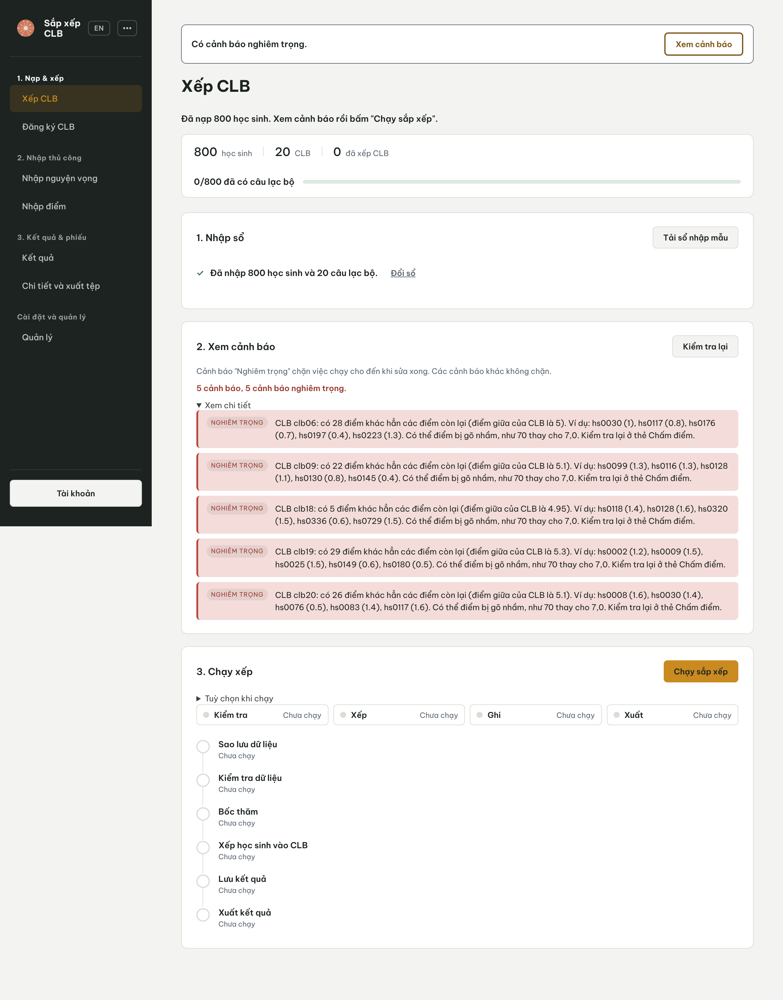

*Ảnh 1: màn «Xếp CLB» sau khi nạp Sổ nhập của trường mô phỏng mặc định (seed dữ liệu 101), trước khi chạy; mục «Xem cảnh báo» liệt kê các cảnh báo kiểm dữ liệu mà phần mềm sinh ra cho bộ này.*

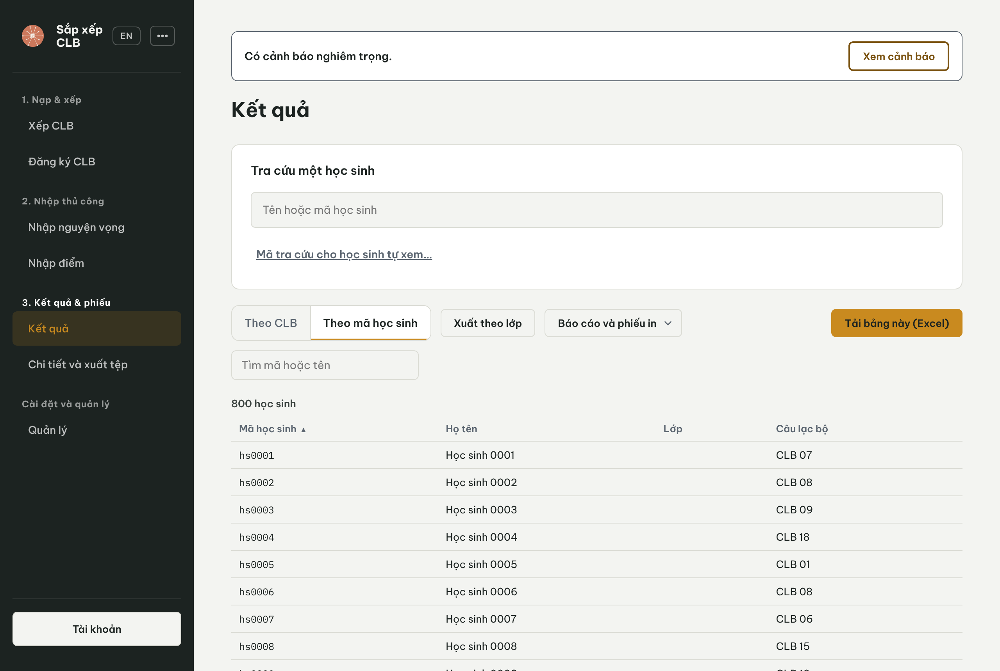

*Ảnh 2: màn «Kết quả» sau một lần chạy (seed bốc thăm 1), chế độ xem theo mã học sinh; chỉ chụp khung nhìn đầu.*

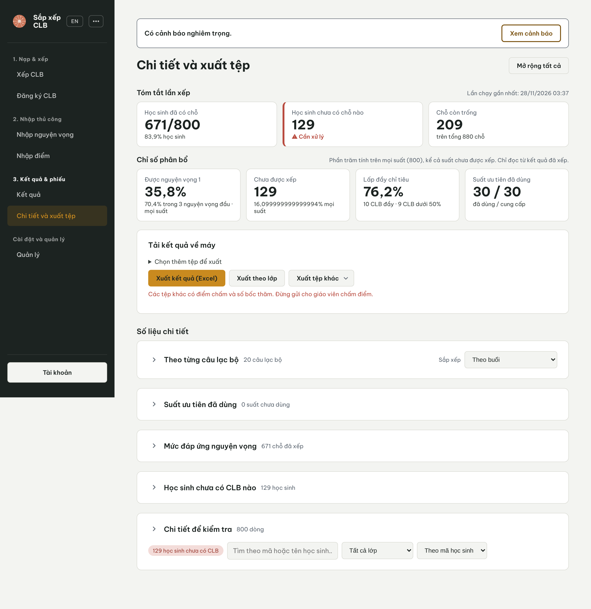

*Ảnh 3: màn «Chi tiết và xuất tệp» với khối «Chỉ số phân bổ» (mục L4 của DG1) cho cùng lần chạy.*

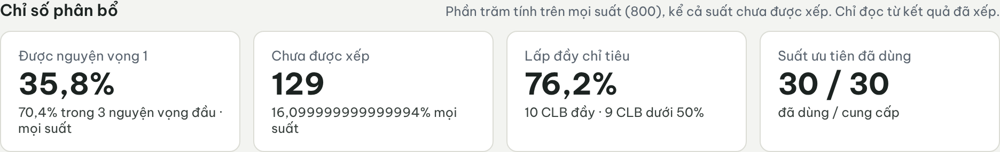

*Ảnh 4: khối «Chỉ số phân bổ» chụp riêng.*

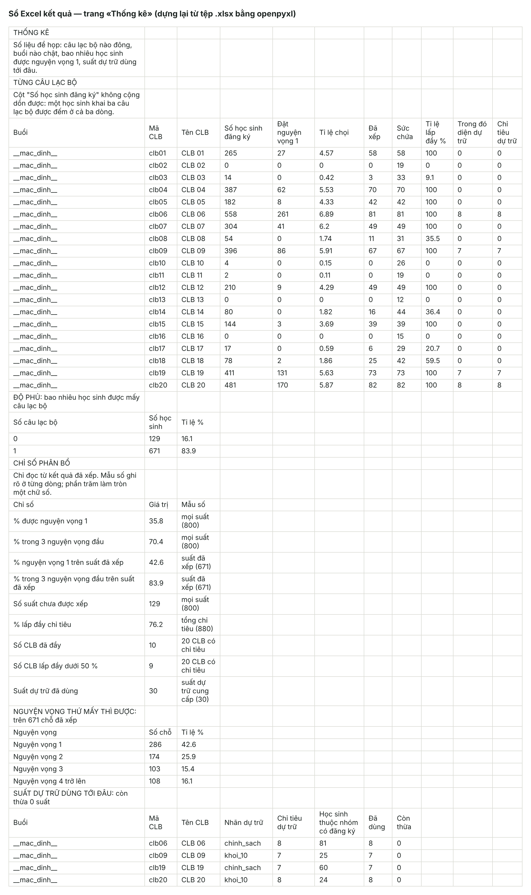

*Ảnh 5: trang «Thống kê» của sổ Excel kết quả xuất từ cùng lần chạy, gồm mục «CHỈ SỐ PHÂN BỔ»; dựng lại thành bảng HTML bằng openpyxl để chụp.*

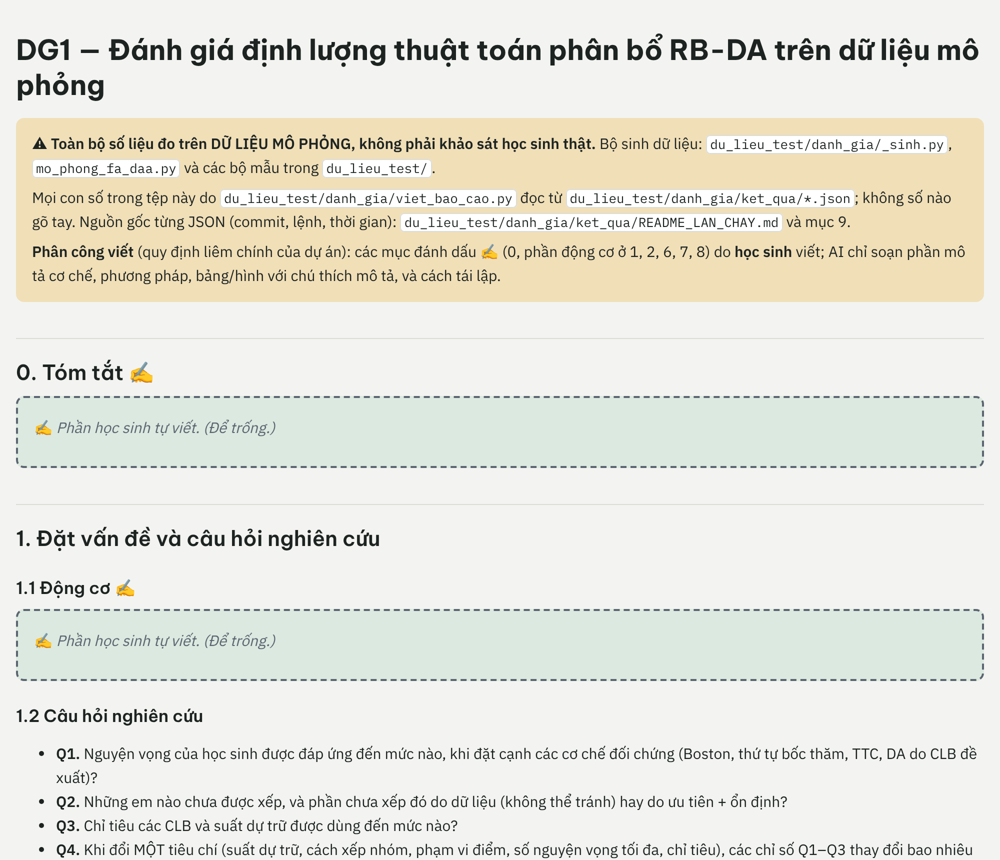

*Ảnh 6: trang đầu bản HTML của báo cáo này.*

## 6. Thảo luận ✍

Câu hỏi gợi ý (trung tính, không kèm đáp án; học sinh có thể bỏ):

1. Ở α nào khoảng cách % NV1 giữa RB-DA và Boston lớn nhất, nhỏ nhất? Đổi lại, cột «Cặp phá vỡ» của hai cơ chế khác nhau thế nào?
2. Trong phần chưa xếp ở cấu hình mặc định, bao nhiêu là «không thể tránh» và bao nhiêu là phần chênh với cận trên? Phần chênh đó đổi ra sao khi κ tăng?
3. Vì sao «DA do CLB đề xuất» trùng RB-DA trên phần lớn dữ liệu sinh, nhưng khác trên `bo_kich_tran`?
4. Ở Bảng 4, biến thể nào làm nhiều em đổi CLB nhất, và số «lên hạng» so với «xuống hạng» của biến thể đó ra sao?
5. Khi bật suất dự trữ, nhóm `khoi_10` và nhóm `khong` thay đổi % NV1 và % được xếp bao nhiêu (Bảng 5)?
6. Giữa các lần bốc thăm của cùng một trường, bao nhiêu % học sinh lúc có chỗ lúc không? Điều đó liên quan gì đến cách công bố kết quả?

<!-- HS:thao_luan BẮT ĐẦU — phần học sinh viết; script sinh lại KHÔNG ghi đè -->
> ✍ *Phần học sinh tự viết. (Để trống.)*
<!-- HS:thao_luan KẾT THÚC -->

## 7. Hạn chế ✍

Các giới hạn của thiết kế thí nghiệm (sự kiện, không đánh giá):

- Mọi số liệu đo trên dữ liệu mô phỏng; chưa có dữ liệu học sinh thật nào trong báo cáo này.
- Một mô hình sở thích duy nhất (α·độ phổ biến + nhiễu đều); danh sách nguyện vọng dài 3–6 CLB.
- 5 trường mô phỏng cho mỗi cấu hình; KTC kiểu t với 4 bậc tự do.
- Một máy đo thời gian (`Linux-6.18.44-fc-v880-x86_64-with-glibc2.39`, Python 3.13.18); thời gian trên máy kiosk Windows chưa đo trong lần chạy này.
- Mô hình hành vi khai huy chương (lười / thật thà / chiến lược) lấy từ `mo_phong_fa_daa.py`, không từ quan sát.

<!-- HS:han_che BẮT ĐẦU — phần học sinh viết; script sinh lại KHÔNG ghi đè -->
> ✍ *Phần học sinh tự viết. (Để trống.)*
<!-- HS:han_che KẾT THÚC -->

## 8. Kết luận ✍

<!-- HS:ket_luan BẮT ĐẦU — phần học sinh viết; script sinh lại KHÔNG ghi đè -->
> ✍ *Phần học sinh tự viết. (Để trống.)*
<!-- HS:ket_luan KẾT THÚC -->

## 9. Tái lập

```bash
python du_lieu_test/danh_gia/do_danh_gia.py --day-du --phan doi_chieu mac_dinh co_che bien_the quet nhieu_buoi co_san
python du_lieu_test/danh_gia/do_danh_gia.py --day-du --phan thoi_gian
python du_lieu_test/danh_gia/do_tinh_nang.py --day-du
python du_lieu_test/danh_gia/kiem_ket_qua.py
python du_lieu_test/danh_gia/viet_bao_cao.py
```

| Tệp JSON | Commit | Lệnh | Giây (tích luỹ) | Bắt đầu | Python |
|---|---|---|---|---|---|
| bien_the_tieu_chi.json | `d428f0851c` | `python du_lieu_test/danh_gia/do_danh_gia.py --day-du --phan doi_chieu mac_dinh co_che bien_the quet nhieu_buoi co_san` | 289.6 | 2026-11-28 03:02:25 | 3.13.18 |
| bo_co_san.json | `17af13a152` | `python du_lieu_test/danh_gia/do_danh_gia.py --day-du --phan co_san nhieu_buoi` | 26.1 | 2026-11-28 03:24:00 | 3.13.18 |
| co_che_doi_chung.json | `d428f0851c` | `python du_lieu_test/danh_gia/do_danh_gia.py --day-du --phan doi_chieu mac_dinh co_che bien_the quet nhieu_buoi co_san` | 104.9 | 2026-11-28 03:02:25 | 3.13.18 |
| doi_chieu_so_lieu.json | `17af13a152` | `python du_lieu_test/danh_gia/do_danh_gia.py --day-du --phan co_san nhieu_buoi` | 0.3 | 2026-11-28 03:24:00 | 3.13.18 |
| mac_dinh.json | `d428f0851c` | `python du_lieu_test/danh_gia/do_danh_gia.py --day-du --phan doi_chieu mac_dinh co_che bien_the quet nhieu_buoi co_san` | 14.4 | 2026-11-28 03:02:25 | 3.13.18 |
| nhieu_buoi.json | `17af13a152` | `python du_lieu_test/danh_gia/do_danh_gia.py --day-du --phan co_san nhieu_buoi` | 12.9 | 2026-11-28 03:24:00 | 3.13.18 |
| quet_quy_mo.json | `d428f0851c` | `python du_lieu_test/danh_gia/do_danh_gia.py --day-du --phan doi_chieu mac_dinh co_che bien_the quet nhieu_buoi co_san` | 1162.7 | 2026-11-28 03:02:25 | 3.13.18 |
| thoi_gian.json | `c209817a57` | `python du_lieu_test/danh_gia/do_danh_gia.py --day-du --phan thoi_gian` | 23.5 | 2026-11-28 03:22:21 | 3.13.18 |
| tinh_nang.json | `d428f0851c` | `python du_lieu_test/danh_gia/do_tinh_nang.py --day-du` | 394.3 | 2026-11-28 03:02:25 | 3.13.18 |

Kiểm tự động: `kiem_ket_qua.py` (mọi ô cặp phá vỡ và xếp ngoài danh sách của RB-DA = 0; được xếp ≤ cận trên; đối chiếu bộ TEST). Test: `python -m pytest -q tests/test_dg1_*.py`.

## 10. Tài liệu tham khảo

- Gale, D., & Shapley, L. S. (1962). College admissions and the stability of marriage. *The American Mathematical Monthly*, 69(1), 9–15.
- Kominers, S. D., & Sönmez, T. (2016). Matching with slot-specific priorities: Theory. *Theoretical Economics*, 11(2), 683–710.
- Abdulkadiroğlu, A., Che, Y.-K., & Yasuda, Y. (2015). Expanding “choice” in school choice. *American Economic Journal: Microeconomics*, 7(1), 1–42.

---
*Sinh bởi `du_lieu_test/danh_gia/viet_bao_cao.py`. Toàn bộ số liệu đo trên DỮ LIỆU MÔ PHỎNG, không phải khảo sát học sinh thật.*
